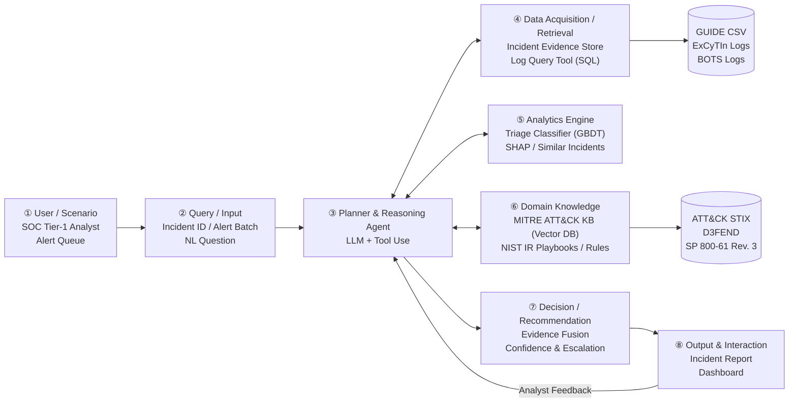
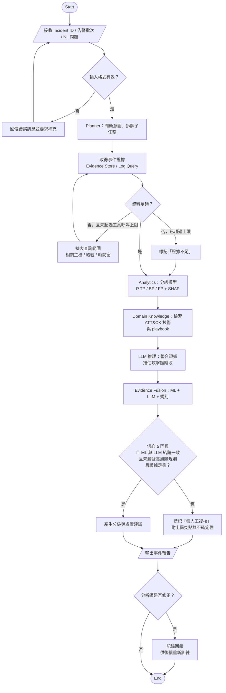

# AI SOC Analyst Agent：結合 MITRE ATT&CK 領域知識與 LLM 推理的資安告警分級代理人

> Final Project Proposal — AIOT
> 第 16 組：蘇恩平、周妤、袁靖淇、蕭宥瑄
> Proposal 階段，2026 年 11 月

---

## 1. Abstract

**[A. Attention Getter]** Modern Security Operations Centers (SOCs) are overwhelmed by tens of thousands of alerts daily, of which only a small fraction represent actual malicious intrusions. Global breach metrics highlight this acute operational pressure: the IBM Cost of a Data Breach Report 2026 reveals an all-time high average breach cost of $4.99 million (+12% year-over-year) and an average lifecycle of 247 days from breach to containment, while Mandiant M-Trends 2026 reports a global median attacker dwell time of 14 days (surging to 122 days in cyber espionage incidents). Concurrently, national telemetry, such as Taiwan National Security Bureau's 2026 disclosure of 2.63 million daily cyber probes targeting critical infrastructure (+6% from 2024), underscores the relentless barrage of external threats. In this high-stakes environment, rapid and reliable triage is the critical bottleneck in preventing severe damages.

**[B. But]** Massive volumes of false positives and benign triggers lead to pervasive analyst alert fatigue, creating substantial risks of overlooking genuine intrusions. Existing automated triage solutions suffer from critical shortcomings: standalone Machine Learning (ML) classifiers scale well across enterprise telemetry but lack Kill Chain semantic context; conversely, recent empirical evaluations demonstrate that five mainstream tool-using LLM agent strategies suffer from a false negative rate of at least 40.4% on attack-related alerts, primarily due to premature termination when queries yield empty results. Furthermore, on the ExCyTIn-Bench benchmark, state-of-the-art LLMs achieve an investigation reward of only 0.606. Moreover, increased opaque automation induces automation complacency among analysts, diminishing human vigilance.

**[C. Cure]** To overcome these foundational limitations, we propose the **AI SOC Analyst Agent**—a domain-specific AI system that orchestrates Machine Learning classification, MITRE ATT&CK contextual reasoning, and LLM agentic planning. The system provides evidence-grounded, explainable triage for security incidents across True Positive (TP), Benign Positive (BP), and False Positive (FP) categories, equipped with a rigorous human-in-the-loop escalation policy that knows precisely when an incident must be handed over to human analysts.

**[D. Development]** The agent employs an eight-module architecture. A Gradient Boosted Decision Tree (GBDT) model, trained on analyst-labeled enterprise telemetry, computes calibrated incident probabilities (TP/BP/FP) accompanied by TreeSHAP local feature explanations. Simultaneously, a vector database retrieves formal MITRE ATT&CK techniques and NIST SP 800-61 Rev. 3 incident handling playbooks. An LLM planner conducts multi-step evidence gathering and hypothesis verification via structured SQL log query tools. Finally, an evidence fusion engine reconciles ML predictions, ATT&CK tactical kill-chain rules, and LLM reasoning. Grounded in the "Assume Breach" and "Asymmetric Error Cost" doctrines, the system systematically escalates incidents to human analysts whenever prediction confidence falls below threshold $\tau$, conclusions conflict, investigative evidence is insufficient, or late-stage tactics (e.g., Exfiltration) are detected.

**[E. Experiments]** We evaluate the proposed system on two benchmark suites: Microsoft GUIDE (encompassing ~1 million real-world enterprise incidents across 6,100 customer organizations) for triage accuracy, and ExCyTIn-Bench (57 log tables, 8 authentic attack chains) for agentic multi-hop log investigation. Baselines include majority-class heuristic, detector-level historical false positive rules, standalone GBDT, and standalone LLM without knowledge retrieval. Primary evaluation metrics comprise Macro-F1, TP False Negative Rate (FNR), Human Escalation Rate, ATT&CK mapping accuracy, report qualitative scoring, and execution cost (token usage and latency). Ablation studies isolate the quantitative contributions of knowledge retrieval, ML probability priors, and escalation logic.

**[F. Expected Outcomes]** As this project is currently in the proposal phase, empirical evaluations are pending. We hypothesize: (1) integrating domain knowledge constraints and calibrated escalation rules will significantly reduce TP False Negative Rates compared to standalone ML and LLM baselines; (2) the operational trade-off curve between Miss Rate and Human Escalation Rate can be quantitatively mapped to provide actionable tuning for tiered SOC teams; and (3) structured ATT&CK retrieval will demonstrably improve tactic mapping precision and report verifiability for Tier-1 analysts. All empirical validations will be executed and documented in the final capstone deliverable.

**Keywords**: Security Operations Center (SOC), Alert Triage, LLM Agent, MITRE ATT&CK, Explainable AI (SHAP), Human-in-the-Loop, Spec-Driven Development.

### 繁體中文重點說明

1. **研究動機（Attention Getter）**：
   - 引用 2026 最新官方與產業實證數據：IBM 2026 報告全球資料外洩成本創 499 萬美元新高、偵測至圍堵週期長達 247 天；Mandiant M-Trends 2026 指出攻擊者潛伏期中位數為 14 天（間諜攻擊達 122 天）；國安局 2026 數據顯示關鍵基礎設施每日面臨 263 萬次侵擾。強調第一線 SOC 告警分級是圍堵災情最嚴峻的瓶頸。
2. **現有方法瓶頸與 Research Gap（But）**：
   - 告警疲勞源於誤報與良性觸發（BP）；純 ML 缺少攻擊鏈脈絡；LLM Agent 在查無紀錄時易誤判提前結案，主流策略漏判率高達 40.4% [3]，在 ExCyTIn-Bench 基準評測僅得 0.606 reward [4]；過度自動化更造成分析師自滿偏誤（Automation Complacency）[12]。
3. **解決方案（Cure）**：
   - 提出結合 ML 分級、MITRE ATT&CK 知識圖譜與 LLM 推理的 **AI SOC Analyst Agent**，提供具備證據鏈、可解釋性，且「知所進退（明確升級給人類）」的智慧代理人。
4. **系統方法論（Development）**：
   - 以系統架構 ①–⑧ 為基礎：GBDT 預測 TP/BP/FP 機率並搭配 TreeSHAP 解釋；向量知識庫檢索 ATT&CK 與 NIST 應變指引；LLM 執行 Log 證據收集；證據融合模組於低信心、衝突、證據不足或晚期戰術時觸發升級機制。
5. **實驗設計（Experiments）**：
   - 使用 Microsoft GUIDE（100 萬起事件、6.1k 組織）與 ExCyTIn-Bench（57 張 Log 表、8 條攻擊鏈）。評估指標包含 Macro-F1、TP 漏判率、升級率、ATT&CK 對應準確率與 Token 成本，並進行消融實驗。
6. **預期成果（Expected Outcomes）**：
   - 遵守真實性原則，標明為預期成果：預期漏判率顯著低於純 GBDT 與純 LLM；能繪出「漏判率 vs. 升級率」取捨曲線；提升報告可驗證性與可解釋性。

## 2. Introduction

### 2.1 Attention Getter: The Widening Gap Between Attack Scale and Defender Response

Modern enterprises face an unprecedented surge in cyber threats that far outpaces the capacity of human defenders. According to Taiwan's National Security Bureau (NSB) 2026 disclosure, adversaries launched approximately 2.63 million daily cyber probe and intrusion attempts against Taiwan's critical infrastructure in 2025—a 6% increase from 2024 [23]. These figures represent the volume of externally originating network probes and attack attempts, not the number of alerts processed within enterprise SOC queues; the distinction is critical for avoiding misinterpretation of the operational burden on analysts.

The economic and temporal consequences of successful intrusions are severe. The IBM Cost of a Data Breach Report 2026 reveals an all-time high average breach cost of \$4.99 million (+12% year-over-year), with an average breach lifecycle of 247 days from initial compromise to containment [14]. Organizations that extensively deployed AI and automation in their security workflows achieved average savings of \$1.93 million per breach and shortened their response cycle by 65 days compared to those with no AI deployment [14]. Concurrently, Mandiant M-Trends 2026 reports a global median attacker dwell time of 14 days in 2025—an increase from 11 days in 2024—with cyber espionage campaigns and North Korean IT worker cases extending median dwell times to 122 days [15]. These metrics collectively underscore a fundamental tension: while the scale and sophistication of threats continue to escalate, the speed of detection and containment remains the decisive factor in limiting operational and financial damage.

#### 繁體中文重點說明

- **攻擊規模**：國安局 2026 年揭露，2025 年每日遭受約 263 萬次「網路侵擾嘗試」（cyber probe/intrusion attempts），較 2024 年增加 6%。**重要澄清**：此數字為外部對關鍵基礎設施的侵擾次數，非 SOC 內部告警量，兩者不可混用。
- **外洩代價**：IBM 2026 報告顯示，全球平均資料外洩成本創 499 萬美元新高（+12%），從發生到圍堵平均需 247 天；大量使用 AI 與自動化的組織可節省 193 萬美元、縮短 65 天。
- **潛伏時間**：Mandiant M-Trends 2026 指出，2025 年攻擊者全球潛伏時間中位數為 14 天（較 2024 年的 11 天延長），間諜攻擊與北韓 IT 人員案件達 122 天。
- **核心論點**：偵測與回應速度直接決定損失大小，AI 有機會在此發揮關鍵作用。

---

### 2.2 Background: How Modern SOCs Operate

A Security Operations Center (SOC) is an organization's centralized function for monitoring, detecting, analyzing, and responding to cybersecurity incidents on a continuous basis. Detection feeds originate from a diverse ecosystem of security controls—endpoint protection platforms, email gateways, identity management systems, cloud workload protections, and network sensors—each generating alerts according to their configured detection rules. These alerts are aggregated and correlated by Security Information and Event Management (SIEM) or Extended Detection and Response (XDR) platforms before reaching analysts.

SOC analysts are typically organized in a tiered structure. Tier-1 analysts are responsible for initial alert triage: classifying each incident as a True Positive (TP, confirmed malicious activity), a Benign Positive (BP, correctly detected activity that is authorized or non-threatening within the organization's context), or a False Positive (FP, an alert fired erroneously by the detection logic) [24]. This TP/BP/FP taxonomy is analytically significant: empirical research on real-world SOC workflows demonstrates that the majority of dismissed alerts are actually BPs rather than genuine FPs—the detection fired correctly, but the flagged behavior is legitimate for that organization [24]. Tier-2 and Tier-3 analysts handle confirmed TP incidents that require deeper forensic investigation, containment, eradication, and recovery.

During triage, analysts consult security logs and telemetry, verify account and host context, and map alerts to attack knowledge frameworks such as MITRE ATT&CK to determine the stage of the attack progression [10][22]. Formal response procedures follow standards such as NIST SP 800-61 Rev. 3 [13], which—as of its April 2025 revision—reorganizes incident response around the six functions of the NIST Cybersecurity Framework (CSF) 2.0 and explicitly recommends that incidents should be prioritized through structured triage rather than processed in arrival order.

**Relevance to AIoT**: Internet of Things (IoT) and Operational Technology (OT) devices in enterprise networks typically cannot support endpoint protection agents; their anomalies surface in the SOC via network-layer and identity-layer alerts. The proposed system processes alerts at the incident level, integrating evidence from multiple detection sources and reasoning over ATT&CK tactics—a framework that also offers an ICS matrix for industrial control systems. This design is intentionally device-type agnostic, making it extensible to AIoT and OT monitoring contexts.

#### 繁體中文重點說明

- **SOC 架構**：SIEM/XDR 彙整各類偵測工具的告警，Tier-1 負責初步分級（TP/BP/FP），Tier-2/Tier-3 負責深入調查與應變。
- **BP ≠ FP 的重要性**：Alahmadi 等人 [24] 研究顯示，大量被稱為「誤報」的告警其實是良性觸發（BP），應分開衡量，本專題的三分類設計（TP/BP/FP）正確反映此實務。
- **分析師工作流程**：分級時需對照 MITRE ATT&CK 判斷攻擊階段，並依 NIST SP 800-61 Rev. 3 執行應變流程，不再依到達先後排序事件。
- **與 AIoT 關聯**：本專題以事件為單位整合多來源告警，ATT&CK 有 ICS 矩陣，可延伸至工控與 IoT 裝置的監控情境。

---

### 2.3 Problem: Alert Triage as the Critical Bottleneck

Enterprise SOCs are routinely overwhelmed by alert volumes far exceeding their analysts' processing capacity. Research on large-scale SOC operations reveals that analysts must simultaneously manage hundreds of queued incidents, yet queue ordering often relies on little more than alert arrival time or coarse severity scores—neither of which reliably reflects actual threat priority [7]. This volume problem is compounded by the composition of the alert stream: in the Microsoft GUIDE dataset—the largest publicly available real-world enterprise incident dataset—only 20.6% of incidents are TP, while 49.0% are BP and 30.4% are FP [1]. The practical consequence is pervasive **alert fatigue**: analysts overwhelmed by high volumes of non-actionable alerts risk desensitization to genuine threats [8][9].

The core problem this project addresses is therefore:

> **Can an AI Agent, integrating machine learning triage, cybersecurity domain knowledge, and LLM-based reasoning, produce evidence-grounded, explainable incident classifications—with a principled policy governing when cases must be escalated to human analysts?**

#### 繁體中文重點說明

- **告警量問題**：SOC 每天面對的告警中，真實惡意事件（TP）只佔 20.6%，良性觸發（BP）49%，誤報（FP）30.4%（GUIDE 資料集 [1]）。
- **排序問題**：大型 SOC 有數百起待處理事件，但排序多依到達時間或粗略嚴重度 [7]，優先順序不可靠。
- **告警疲勞**：大量非可行動告警導致分析師疲勞，真正的攻擊反而被忽略 [8][9]。
- **核心問題**：能否設計一個 AI Agent，結合 ML、領域知識與 LLM 推理，提供有依據、可解釋，且知道何時交給人的分級決策？

---

### 2.4 Existing Limitations of Current Approaches

Current approaches to automated SOC triage suffer from five critical gaps that this project aims to address:

**1. ML classifiers lack kill chain context.** ML-based triage systems, including Microsoft's large-scale Copilot Guided Response (CGR) [1] and Adaptive Incident Prioritization (AIP) [7], can achieve high accuracy at enterprise scale—CGR reports a cross-region macro-F1 of 0.87 for TP/BP/FP classification. However, these models primarily learn statistical similarity to historical TP patterns; they do not explicitly reason about what a given alert means within the progression of an attack chain. Kill chain context is precisely the information analysts rely on to assess severity and urgency [10][11].

**2. LLM Agents exhibit high false negative rates.** LLM agents offer flexible, query-driven investigation capabilities, but systematic empirical evaluation reveals critical failure modes: across five mainstream tool-using LLM reasoning strategies, every approach misses at least 40.4% of attack-related alerts, with false negatives occurring most frequently when queries return empty results—a "no evidence" finding is incorrectly treated as "no attack" [3]. On the ExCyTIn-Bench threat investigation benchmark (57 log tables, 8 real attack chains), the best-performing model achieves an investigation reward of only 0.606, with performance degrading substantially to 0.248 when alerts are removed from the query context [4]. Furthermore, test-time compute scaling—which yields marked improvements in code and mathematics—provides only marginal benefit for security analysis tasks [5].

**3. Domain knowledge is not integrated into triage pipelines.** Methods for mapping alerts to ATT&CK tactics predominantly address threat intelligence text reports [6] rather than raw SOC alerts and logs. Graph-based severity assessment methods that do incorporate kill chain context [10][11] operate as standalone rule systems without integration with ML classifiers or LLM reasoning.

**4. Human-in-the-loop design is neglected.** Most automated systems produce only a final verdict without an explicit policy for when and how to escalate to human review. Research on SOC automation demonstrates that increasing automation induces *automation complacency*: analysts reduce their monitoring vigilance and over-rely on automated outputs [12]. Critically, field deployment evidence shows that analyst adoption of AI outputs depends primarily on output *verifiability* rather than raw accuracy [26], and that systematic verification procedures can mitigate complacency [12].

**5. Evaluations lack reproducibility.** Systematic reviews of AI-based alert filtering identify persistent deficits in operational validation and methodological consistency [8]. Commonly used benchmark datasets carry significant quality concerns—for instance, over 20% of CICIDS2017 flows require reconstruction or re-labeling due to dataset construction artifacts [17]—while evaluation pitfalls in ML security research are broadly documented [16].

#### 繁體中文重點說明

1. **ML 缺少攻擊鏈脈絡**：CGR [1] 的 macro-F1 達 0.87，但主要學習「像不像過去的 TP」，不明確說明告警在攻擊鏈中的意義，而攻擊鏈位置是判斷嚴重度的關鍵 [10][11]。
2. **LLM 漏判率高**：五種主流 LLM 推理策略都漏判至少 40.4% 的攻擊告警 [3]；ExCyTIn-Bench 最佳 reward 僅 0.606，移除告警表降至 0.248 [4]；推理模型在資安的 scaling 效益遠不如程式或數學 [5]。
3. **領域知識未整合**：ATT&CK 對應方法多處理威脅情資文字 [6]，攻擊鏈圖方法 [10][11] 是獨立規則系統，沒有與 ML/LLM 整合。
4. **缺少人機協作設計**：自動化加劇分析師自滿偏誤 [12]；影響採用的關鍵是輸出是否容易驗證 [26]，而非準確率。
5. **評估難以重現**：缺乏一致的評估方法 [8]；CICIDS2017 超過 20% 流量需重建 [17]；ML 資安評估陷阱普遍存在 [16]。

---

### 2.5 Innovation: How This Project Differs

The proposed AI SOC Analyst Agent addresses the five limitations identified above through a principled integration of complementary approaches. The following comparison table contrasts existing methods with the proposed design across six dimensions:

| Dimension | Existing Approaches | Proposed AI SOC Analyst Agent |
|---|---|---|
| **Classification basis** | Standalone ML model, or standalone LLM | **Evidence fusion**: ML calibrated probability + LLM multi-step reasoning + ATT&CK kill chain rules |
| **Domain knowledge use** | Implicit in training data, or applied only to threat intelligence text | **Explicit integration** of ATT&CK knowledge base and kill chain rules; later-stage tactics systematically bias toward escalation |
| **Uncertainty handling** | Binary verdict output only | Explicit escalation when prediction confidence falls below threshold τ, ML/LLM conclusions conflict, high-risk kill chain rules trigger, or evidence is insufficient |
| **Insufficient evidence** | LLM may close the case [3] | Per **Assume Breach** doctrine: expand queries; escalate if budget exhausted with unresolved uncertainty |
| **Explainability** | Numerical score or brief rationale | Each verdict includes a **full evidence chain**: SHAP feature attributions, similar historical incidents, mapped ATT&CK techniques, and data source citations |
| **Evaluation** | Accuracy only | Reports both **TP False Negative Rate and Human Escalation Rate**; reproducible evaluation on two public datasets |
| **Comparison with AIDA [3]** | Reasoning, challenge, and judgment all performed by LLM; evaluated on single data series; ~34k tokens/alert | Triage probability from GBDT trained on real analyst labels; LLM cannot unilaterally decide; ATT&CK knowledge and kill chain rules as hard constraints; escalation policy encoded as auditable rules; evaluated on 6.1k-organization GUIDE dataset |

#### 繁體中文重點說明

- **證據融合**：本專題的核心創新是將三種方法（ML 機率、LLM 推理、ATT&CK 規則）整合，不讓任何一個單獨決定結果。
- **升級機制**：明確定義四種升級條件（信心不足、ML/LLM 衝突、高風險規則觸發、證據不足），並依 Assume Breach 原則擴大查詢。
- **可解釋性**：每個結論都附完整證據鏈（SHAP 特徵、相似事件、ATT&CK 技術、資料來源），讓分析師有依據可驗證。
- **評估**：同時報告漏判率與升級率，在兩個公開資料集上可重現，直接回應評估不一致的問題。
- **與 AIDA [3] 的差異**：本專題的分級機率來自在真實標籤上訓練的 GBDT，不完全依賴 LLM；ATT&CK 規則作為硬性約束，升級條件是可審核的規則，而非 LLM 自由裁量。

---

### 2.6 Contributions

This project makes the following five anticipated contributions:

**1. System contribution.** We design and implement a modular AI agent for SOC alert triage that integrates ML-based probability estimation, ATT&CK knowledge retrieval, and LLM-based multi-step evidence collection within a clearly defined eight-module architecture (modules ①–⑧), providing a reproducible and extensible reference implementation.

**2. Methodological contribution.** We propose evidence fusion and escalation algorithms (Algorithms 1 and 2) that operationalize domain principles—Assume Breach, kill chain context-awareness, and asymmetric error cost—as explicit, auditable decision rules rather than implicit model behaviors.

**3. Experimental contribution.** We conduct rigorous evaluation on two public datasets: Microsoft GUIDE (triage accuracy) and ExCyTIn-Bench (agentic log investigation), comparing against majority-class, rule-based, standalone GBDT, and standalone LLM baselines. Data splits respect organizational boundaries (GroupKFold by organization and incident ID) to prevent data leakage. Ablation studies quantify the marginal contribution of each component.

**4. Domain research contribution.** We synthesize five core SOC mindsets, three domain controversies, and ten deep-understanding questions that translate cybersecurity domain knowledge into concrete system design decisions—forming a reusable analytical framework for AI-augmented SOC research.

**5. Reproducibility and handover.** All source code, data processing pipelines, DESIGN.md, and READMEs are published to enable other researchers and developers to understand, execute, verify, and extend this work.

#### 繁體中文重點說明

1. **系統貢獻**：整合 ML + ATT&CK 知識庫 + LLM 的八模組 SOC 分級 Agent，架構清楚分工，可延伸。
2. **方法貢獻**：證據融合與升級演算法（Algorithm 1、2），將 Assume Breach、攻擊鏈脈絡、錯誤成本不對稱等領域原則轉為明確的可審核決策規則。
3. **實驗貢獻**：在 GUIDE 與 ExCyTIn-Bench 上對比多個 baseline，以組織為單位切分資料避免資料洩漏，消融實驗量化各模組貢獻。
4. **領域研究貢獻**：五個核心思維模式、三個專業爭論、十個深度理解問題，形成可重用的分析框架。
5. **可重現**：公開原始碼、資料流程與完整文件，確保可繼續開發。

## 3. Related Work

> 本節文獻共 16 篇：AI Technology 8 篇（[1]–[7]、[26]）、Domain Know-How 8 篇（[8]–[13]、[24]、[25]），篇數比例各 50%。所有文獻均經 URL / DOI 實測查證（Verified: Y / Paywall-OK），依規範採學術英文撰寫主要段落，每節末附繁體中文重點說明。
> Limitation 欄位標示「Authors:」者取自原文限制章節；其餘依原文內容整理。

### 3.1 AI Technology

#### (1) ML-Based Alert Triage and Incident Prioritization

Microsoft's Copilot Guided Response (CGR) [1] introduced a production-deployed ML architecture that simultaneously addresses three SOC tasks—investigation (via similar historical incident retrieval), triage (TP/BP/FP classification), and remediation suggestion. Crucially, the work released the GUIDE dataset: approximately 13 million evidence rows, 1.6 million alerts, 1 million incidents across 6,100 customer organizations, with labels derived from real analyst decisions—the largest publicly available real-world enterprise incident dataset to date. CGR reports cross-region macro-F1 of 0.87 for TP/BP/FP classification, with precision 0.87 and recall 0.86. A companion work, Adaptive Incident Prioritization (AIP) [7], addresses the queue ordering problem by adapting BM25 information retrieval concepts into a query-free, cross-tenant ranking algorithm, achieving 92.8% Precision@10 in expert evaluation and extending GUIDE with 9,980 prioritization-labeled incidents. Together, these works establish that ML triage is industrially deployable at scale—yet the advantage derives substantially from vendor-internal cross-customer data and product integration context that is not publicly reproducible.

#### (2) LLM Agents for Alert Investigation

CORTEX [2] proposes a multi-agent LLM architecture—decomposing alert investigation into behavioral analysis, evidence collection, and reasoning sub-agents—and demonstrates improvements over single-agent baselines: actionable alert F1 improves from 0.66 to 0.78, and false positive rate decreases from 24.9% to 14.2%. However, Tsegai et al. [3] conduct a more systematic empirical study, evaluating five distinct tool-using LLM reasoning strategies and finding that **all existing strategies miss at least 40.4% of attack-related alerts**. The dominant failure mode is premature case closure when queries return empty results—an absence of logged evidence is incorrectly interpreted as an absence of malicious activity. In-context self-review is found to have a net-negative effect. Their proposed AIDA system, introducing independent adversarial challenger and judge agents, reduces the false negative rate to 3.1% (F1 0.958) at the cost of a 18.4% human escalation rate and approximately \$0.109 per alert (GPT-4.1). This work establishes that **the termination policy—when to stop investigating and when to escalate—is the most consequential design decision in LLM-based alert triage**.

#### (3) Security LLM Benchmarks

ExCyTIn-Bench [4] evaluates LLM agents on threat investigation within a controlled Azure tenant (57 log tables, 8 authentic attack chains, 7,542 auto-generated questions). The best-performing model achieves an investigation reward of only 0.606; removing alert tables from the queryable database causes performance to drop to 0.248, confirming agents' over-reliance on alert-level context. CyberSOCEval [5], part of the CyberSecEval 4 suite, benchmarks malware analysis (609 questions) and threat intelligence reasoning (588 questions across 45 real reports), finding that model accuracy ranges from 15–28% and 43–53% respectively—far below saturation—and that test-time compute scaling yields substantially smaller improvements in security analysis than in code generation or mathematics. Both benchmarks establish a consistent finding: **general-purpose LLMs remain significantly below expert-level performance on security reasoning tasks**.

#### (4) Domain Knowledge Retrieval via RAG

TechniqueRAG [6] addresses ATT&CK technique annotation in cyber threat intelligence (CTI) text using a retriever-augmented pipeline with an instruction-tuned LLM and zero-shot reranking. On the Procedures benchmark, TechniqueRAG achieves F1 of 91.09% with minimal labeled data, establishing state-of-the-art performance. However, two important limitations constrain applicability to our problem: (a) the method is designed for CTI text reports, not for structured SOC alert telemetry and security logs; and (b) on the multi-label Expert benchmark (covering 290 techniques), the best system achieves only ~50% F1, with models rarely outputting more than two techniques—indicating low recall in multi-tactic attack scenarios.

#### (5) Field Deployment of LLM Agents in SOC

Banstola et al. [26] conducted a 14-month participatory field study deploying an LLM ReAct agent collaboratively designed with analysts at a university SOC. During the final four active months, analysts incorporated the agent's output into case closure reports in over 90% of cases. For the three most frequent users, the estimated time savings were 30–50% relative to self-reported manual processing times. The study identifies **output verifiability—not accuracy—as the primary determinant of analyst adoption**: analysts were more willing to adopt outputs they could independently check, and self-customization of agent behavior further increased trust.

#### 繁體中文重點說明

1. **ML 分級**：CGR [1] macro-F1 0.87，但優勢依賴廠商跨客戶資料；AIP [7] 解決佇列排序問題，Precision@10 達 92.8%。
2. **LLM Agent**：CORTEX [2] F1 從 0.66 → 0.78；但 Tsegai 等人 [3] 發現所有現有方法漏判至少 40.4%，「何時停止調查」是最關鍵設計；AIDA 透過獨立質疑與裁判機制將漏判率降至 3.1%，代價是 18.4% 升級率。
3. **Benchmark**：ExCyTIn-Bench [4] 最佳 reward 0.606，移除告警表降至 0.248；CyberSOCEval [5] 顯示推理模型在資安的 scaling 效益遠不如程式或數學。
4. **RAG**：TechniqueRAG [6] 在 CTI 文字上 F1 91.09%，但只處理文字報告，多標籤情境召回率低。
5. **實地部署**：Banstola 等人 [26] 實地研究發現，採用 AI 輸出的關鍵是**可驗證性**，而非準確率。

---

### 3.2 Domain Know-How

#### (1) Alert Fatigue as a Structural SOC Problem

Ndichu et al. [8] conduct a systematic review of AI-based alert screening research spanning 2015–2026, analyzing 87 core studies from an initial pool of 119 references. They organize the alert management literature into four stages—filtering, triage, correlation, and generative augmentation—and identify four persistent research gaps: (i) absence of operational validation in real production SOC environments; (ii) insufficient adversarial robustness; (iii) limited cross-environment generalization; and (iv) lack of methodological consistency in evaluation. They propose a "Cognitive SOC" research agenda to address these deficiencies. Habibzadeh et al. [9] complement this with a comprehensive survey of LLM applications in SOC workflows, characterizing the structural challenges as: excessive alert volume, analyst staffing shortages, high domain expertise requirements, response latency, and difficulty operationalizing threat intelligence. They organize LLM SOC applications by workflow stage—log analysis, alert triage, and threat intelligence—and claim this as the first comprehensive survey specifically addressing LLM integration in SOC contexts.

#### (2) Kill Chain Stage as the Primary Severity Determinant

Sadlek et al. [10] propose mapping detected alert sequences to ATT&CK-derived kill chain attack graphs using MulVAL, assessing severity by the most advanced attack chain stage reached and the importance of compromised assets. On a 10-host testbed running 5 MITRE CALDERA attack scenarios (31 ATT&CK techniques, 475 alert sequences of which 10 are malicious), alert sequence classification achieves AUC 0.95, with a chosen threshold correctly identifying 80% of malicious sequences. ROSCA [11] independently pursues a similar insight, dynamically constructing alert graphs by shared attributes and scoring cases by ATT&CK tactic progression. Evaluated on real hospital SOC data (382 EDR alerts over 2 months), ROSCA outperforms the MATE framework in matching analyst-assigned severity labels. Both works converge on a central domain principle: **the security significance of any individual alert is inseparable from its position and context within the broader attack progression**.

#### (3) Human-Machine Interaction Risk: Automation Complacency

Tilbury and Flowerday [12] investigate whether SOC automation induces analyst complacency through a mixed-methods study combining four SOC site observations, a 696-analyst survey, and 29 in-depth analyst interviews. Using PLS structural equation modeling, they demonstrate that increased automation causes analysts to reduce monitoring vigilance and increase reliance on automated outputs—the *vigilance paradox*. Importantly, they find that systematic verification procedures can mitigate this effect. This finding has direct design implications: an AI SOC agent that presents opaque verdicts without traceable evidence chains not only fails to support analyst judgment but actively degrades it. The companion paper [18] provides further quantitative analysis of human-automation preference formation in SOC contexts.

#### (4) Incident Response Standards

NIST SP 800-61 Rev. 3 [13] (April 2025) replaces the 2012 Rev. 2 version, reorganizing incident response guidance around the six functions of the NIST Cybersecurity Framework (CSF) 2.0: Govern, Identify, Protect, Detect, Respond, and Recover. A key normative change is the explicit recommendation that incidents should be prioritized through structured triage and risk-based analysis rather than first-in-first-out queue management (outcome RS.MA-02). This standard provides the procedural framework for the proposed system's escalation and remediation suggestion components.

#### (5) Analyst Triage Behavior: Empirical Evidence

Alahmadi et al. [24] conduct qualitative research with 21 practitioners across seven SOCs (supplemented by a 20-respondent questionnaire), revealing that the majority of dismissed alerts are **benign positives rather than genuine false positives**: the detection fired correctly, but the flagged behavior is an authorized activity within that organization. This distinction—between FP (detector error) and BP (correct detection, benign activity)—is analytically critical but absent from most ML triage literature. Analysts also identify alert opacity—lack of explanations and contextual information—as a primary impediment to efficient triage. Kersten et al. [25] conduct two think-aloud protocol experiments observing five Tier-1 analysts performing 400 alert investigations at a commercial SOC, developing and evaluating an Alert Investigation Support System (AISS). Key findings include: investigation workflows vary substantially across analysts and alert types; and alerts that ultimately require escalation are associated with significantly greater variety in evidence types collected. This directly motivates adaptive evidence collection depth in the proposed system's LLM planning module.

#### 繁體中文重點說明

1. **告警疲勞**：Ndichu 等人 [8] 回顧 87 篇核心研究，指出四大缺口（營運驗證、對抗穩健性、跨環境泛化、評估一致性），提出 Cognitive SOC 研究議程；Habibzadeh 等人 [9] 整理 LLM 在 SOC 工作流程中的應用分類。
2. **攻擊鏈階段**：Sadlek 等人 [10] 以 Kill Chain 攻擊圖判定嚴重度，AUC 0.95；ROSCA [11] 以 ATT&CK 戰術推進評分，在真實醫院 SOC 資料上優於 MATE。**核心共識**：單一告警的意義取決於在攻擊鏈中的位置。
3. **自動化自滿**：Tilbury 與 Flowerday [12] 以 696 份問卷與 29 場訪談確認自動化讓分析師降低監控；系統性驗證程序可減緩此現象，強調 Agent 必須輸出可驗證的證據鏈。
4. **NIST SP 800-61 Rev. 3**：2025 年 4 月更新，明確建議事件應依風險優先排序（RS.MA-02），不應先到先處理，是本專題處置建議的流程依據。
5. **分析師行為**：Alahmadi 等人 [24] 發現大多數「誤報」實為良性觸發（BP），本專題三分類正確反映此實務；Kersten 等人 [25] 發現需升級的告警會蒐集更多種類的資訊，支持本專題依情況調整證據蒐集深度的設計。

---

### 3.3 Article Summary Table

| Ref. | Year | Problem | AI Method | Domain Knowledge | Dataset | Key Findings | Limitation | Verified |
|---|---|---|---|---|---|---|---|---|
| [1] | 2024 | SOC incident investigation, triage, and remediation | ML (CGR), integrated in Defender XDR | SOC triage (TP/BP/FP), remediation actions | GUIDE: 13M evidence rows, 1.6M alerts, 1M incidents, 6.1k orgs, 2 weeks (public) | Deployed to thousands of customers; macro-F1 0.87, precision 0.87, recall 0.86; 41% incident coverage at 90% precision threshold | Authors: no comparison to other products; limited to known detectors; cannot handle zero-day or unmonitored attack vectors | Y |
| [2] | 2025 | High alert volume; single-LLM instability and opacity under noisy enterprise data | Multi-agent LLM (behavior analysis, evidence collection, reasoning) | SOC investigation workflow, analyst step-by-step actions | Self-constructed SOC investigation traces (10+ real enterprise scenarios, thousands of records, public) | Actionable alert F1: 0.66→0.78; FP rate: 24.9%→14.2% vs. single tool-using agent | Authors: limited scenario count; sensitive to distribution shift, prompt injection, incomplete tool returns; cost: ~5.7× tokens, 152s/alert | Y |
| [3] | 2026 | How LLM reasoning strategies affect evidence collection and case closure timing | 5 tool-using LLM strategies; proposes AIDA (multi-agent challenger + judge) | Alert triage, SIEM investigation | ALERT-BENCH: AIT-LDSv2 telemetry replayed in SIEM; 1,247 alerts from 4-day multi-stage attack scenarios | All existing strategies miss ≥40.4% attacks; AIDA F1 0.958, FNR 3.1%, escalation 18.4%; ~34k tokens, $0.109/alert (GPT-4.1) | Authors: data only from AIT series; lacks organizational context; analyst adoption not evaluated; preprint | Y |
| [4] | 2026 | Lack of benchmark for evaluating LLM agent threat investigation | LLM Agent + SQL tools; questions auto-generated from investigation graphs | Security logs, investigation graphs, detection logic | Controlled Azure tenant: 57 log tables, 8 real attack chains, 7,542 questions | Best model reward 0.606; drops to 0.248 with full DB; alert table removal causes sharp degradation | Derived from text: single tenant; benign noise is simulated; questions LLM-generated from alert graphs, biased toward alert table | Y |
| [5] | 2025 | Lack of benchmarks for malware analysis and threat intelligence reasoning | LLM evaluation (including reasoning models) | Malware analysis, threat intelligence | CyberSOCEval (part of CyberSecEval 4): malware 609 Qs, threat intelligence 588 Qs (45 reports) | Model accuracy 15–28% (malware), 43–53% (TI); larger/newer models better; test-time scaling less effective than in code/math | Authors: malware analysis Windows-only; multiple-choice format; IR and triage listed as future work | Y |
| [6] | 2025 | ATT&CK technique annotation from CTI text requires large labeled datasets | RAG: retriever + instruction-tuned LLM + zero-shot reranker | MITRE ATT&CK techniques | Tram, Procedures, Expert benchmarks (198, 488, 290 techniques respectively) | SOTA with minimal labels: Procedures F1 91.09%; Expert multi-label ~50% | Authors: techniques lack procedure examples; models rarely output >2 techniques; multi-label recall low; ground truth inconsistency; CTI text only, not SOC alerts | Y |
| [7] | 2026 | Incident queues ordered by time or coarse severity; true priority unclear | Modified BM25 cross-tenant ranking + component-level explanations | SOC queue management, domain priors | 1,000-org expert evaluation; 473k org-day queues (production); GUIDE + 9,980 priority labels (499 queues) | Precision@10 92.8%; 17.5% more alert details viewed vs. severity-ordered | Authors: only ranks existing queues; cannot classify TP/FP or surface undetected attacks; ranking depends on ATT&CK mapping, TI, and asset label completeness | Y |
| [8] | 2026 | Lack of systematic review of AI-based alert screening | Survey: filtering, triage, correlation, generative augmentation | Alert fatigue, SOC workflow | 119 references, 87 core studies (2015–2026) | Four-stage classification; identifies 4 research gaps; proposes Cognitive SOC agenda | Authors: excludes non-English literature; most studies use benchmark datasets; preprint submitted to ACM Computing Surveys | Y |
| [9] | 2025 | LLM integration into SOC workflows lacks systematic treatment | Survey: LLM for log analysis, alert triage, threat intelligence | SOC staffing, alert volume, response time challenges | Kitchenham systematic review methodology | Claims first comprehensive LLM-in-SOC survey; organizes by SOC workflow stage | No empirical results (survey); preprint | Y |
| [10] | 2025 | Multi-step attack alerts need severity-based triage | Attack graph matching (MulVAL), non-LLM | Kill chain, ATT&CK, asset criticality | 10-host testbed; 5 MITRE CALDERA scenarios (31 ATT&CK techniques); 475 alert sequences, 10 malicious | Alert sequence classification AUC 0.95; threshold correctly identifies 80% malicious sequences | Authors: small testbed scale, no real user traffic; attack graph scalability issues; MulVAL rules require manual authoring | Y |
| [11] | 2025 | High alert volume causes analyst fatigue; opaque commercial tools impede customization | Non-ML: dynamic alert graph by shared attributes, aggregated into cases, scored by ATT&CK tactic progression | ATT&CK tactic progression (kill chain) | French hospital SOC: EDR alerts (2 months, 382 records) + internal IDS (15 days, 37 records); analyst labels; penetration test data | Scores outperform MATE in matching analyst labels; 382-alert correlation in 0.12s, 1.45MB | Single hospital; small alert count; no Precision/Recall reported; only alerts with deterministic tactic inference included | Paywall-OK |
| [12] | 2026 | Does SOC automation induce analyst complacency and bias? | Non-AI: PLS structural equation modeling | Automation complacency, human-machine trust | 4 SOC observations, 696-analyst survey, 29 interviews | Automation reduces monitoring vigilance; systematic verification procedures mitigate complacency | US analysts only; self-reported data | Paywall-OK |
| [13] | 2025 | Incident response guidance needs integration with CSF 2.0 | — | Incident response lifecycle (CSF 2.0 six functions) | — | Replaces 2012 Rev. 2; RS.MA-02 recommends risk-based triage, not FIFO; Govern function added | High-level guidance; no alert-level decision rules or quantitative thresholds | Y |
| [24] | 2022 | High security tool FP rates, but "false positive" is poorly defined | Non-AI: questionnaire (n=20) + semi-structured interviews (n=21) | Analyst alert verification; FP vs. benign trigger distinction | Practitioners from 7 SOCs, predominantly UK-based | Most "false positives" are benign triggers; alert opacity (no explanation/context) is a primary problem; proposes REACT model | Authors: small sample, 7 SOCs mostly UK/Europe; non-random recruitment; self-reported | Y |
| [25] | 2025 | Little is known about how Tier-1 analysts actually investigate alerts | Non-AI: think-aloud experiments; develops AISS | Tier-1 investigation process, evidence collection patterns | Commercial SOC: 5 analysts, 400 investigations; 4 analysts using AISS for 36 investigations | Workflows vary by analyst and alert type; escalated alerts involve greater evidence type variety; AISS reduces actions needed | Authors: single SOC; subjects mostly junior/intern analysts; same attack investigated repeatedly | Y |
| [26] | 2026 | Will LLM agents be adopted in real SOC practice? | LLM ReAct Agent, participatory design with analysts | SOC ticketing workflow, analyst trust and adoption | University SOC: 14-month field study, 4-month active use period | >90% usage rate for case closure; verifiability is key to adoption; 30–50% time savings for top-3 users | Authors: single university SOC; time comparison vs. self-reported manual baseline; preprint | Y |

---

### 3.4 Research Gap

#### Existing Research

Prior work divides into four clusters, each contributing a necessary but insufficient piece of the solution:

- **ML-based triage** ([1], [7]): Industrially deployed ML classifiers achieve strong accuracy at enterprise scale (macro-F1 0.87 for CGR [1]) and effective queue prioritization (Precision@10 92.8% for AIP [7]). However, their advantage derives from vendor-internal cross-customer data and product integration context. Critically, these models optimize for statistical similarity to historical TP patterns without explicitly encoding kill chain semantics or providing analyst-interpretable evidence chains.

- **LLM Agent investigation** ([2], [3], [4]): LLM agents offer flexible, query-driven investigation but exhibit severe reliability limitations. All mainstream reasoning strategies miss at least 40.4% of attack-related alerts [3], and the best-performing model on the ExCyTIn-Bench threat investigation benchmark achieves an investigation reward of only 0.606 [4]. The fundamental failure mode—premature case closure when queries return empty results—reveals that LLM agents conflate absence of evidence with evidence of absence.

- **Domain knowledge integration** ([6], [10], [11]): ATT&CK-based methods demonstrably improve severity assessment by contextualizing alerts within kill chain progression, with alert sequence classification AUC reaching 0.95 [10]. RAG-based ATT&CK annotation achieves F1 91.09% on CTI text [6]. Yet these methods operate as isolated systems—ATT&CK reasoning is not integrated with ML probability estimation or LLM evidence collection.

- **SOC human factors and practice** ([12], [24], [25], [26]): Empirical research consistently establishes that (a) automation complacency degrades analyst vigilance [12]; (b) output verifiability—not accuracy—determines analyst adoption [26]; (c) the TP/BP/FP distinction is essential but conflated in practice [24]; and (d) escalated cases require richer, more varied evidence collection [25]. These findings establish clear requirements for human-centered agent design that the technical ML and LLM literature largely neglects.

#### Limitations of Current Approaches

1. ML classifiers are strong at pattern recognition but do not explain *what an alert means within the attack chain*—the information analysts most need for severity judgment.
2. LLM agents terminate investigations prematurely under incomplete evidence, and simply increasing inference compute does not improve reliability [3][5].
3. Most systems produce opaque verdicts without explicit escalation policies, lack the evidence chains analysts need to independently verify outputs, and consequently risk exacerbating automation complacency [12][26].
4. Systematic reviews identify evaluation methodology inconsistency and absence of reproducible public benchmarking as a persistent gap [8].

#### Research Gap

The field currently lacks a system that **simultaneously** integrates: (a) ML triage trained on real analyst-labeled data; (b) ATT&CK and kill chain domain reasoning as explicit constraints; (c) LLM-based multi-step evidence collection with a principled termination and escalation policy; and (d) full evidence-chain explainability to support analyst verification—while providing reproducible evaluation on public datasets.

#### Our Project

The proposed AI SOC Analyst Agent is designed to close this gap through five complementary mechanisms:

1. **ML triage on real labels**: GBDT trained on the GUIDE dataset provides stable, calibrated TP/BP/FP probability estimates at scale, eliminating dependence on LLM judgment for the base classification decision (addresses Limitation 1).
2. **Explicit kill chain reasoning**: ATT&CK knowledge retrieval and five programmatic kill chain rules (R1–R5) provide domain-grounded severity constraints; later-stage attack tactics systematically increase escalation priority (addresses Limitation 1).
3. **Principled evidence collection and escalation**: The LLM planning module follows an Assume Breach protocol—empty query results trigger expanded investigation rather than case closure. An explicit escalation policy (Algorithm 2) defines four auditable conditions for human handover: low confidence, ML/LLM conflict, kill chain rule trigger, or evidence budget exhaustion without resolution (addresses Limitation 2 and 3).
4. **Full evidence-chain explainability**: Every verdict includes SHAP feature attributions, similar historical incidents, mapped ATT&CK techniques, and data source citations—enabling analysts to verify rather than accept outputs on faith (addresses Limitation 3).
5. **Reproducible dual-dataset evaluation**: Primary evaluation on GUIDE (triage accuracy, 1M incidents) and ExCyTIn-Bench (agentic log investigation) with organizational-boundary data splits (GroupKFold) prevents data leakage and enables reproducible comparison (addresses Limitation 4).

#### 繁體中文重點說明

- **ML 分級的不足**：準確率高但缺少攻擊鏈脈絡，依賴廠商私有資料，無法提供可驗證的證據鏈。
- **LLM Agent 的不足**：漏判率高（≥40.4% [3]），Benchmark 分數有限（0.606 [4]），增加推理量無法改善可靠性。
- **知識整合的缺口**：ATT&CK / Kill Chain 方法有效但與 ML/LLM 孤立。
- **人因研究的啟示**：自動化自滿 [12]、可驗證性是採用關鍵 [26]、BP≠FP 的區分 [24]、升級告警需更多證據 [25]——這些實務發現在技術論文中多被忽略。
- **Research Gap**：目前沒有系統同時整合「真實標籤 ML 分級」+「ATT&CK 領域推理」+「有升級機制的 LLM 證據收集」+「可驗證的證據鏈」且在公開資料上可重現評估。
- **本專題回應**：五個互補機制（ML 訓練於 GUIDE、Kill Chain 規則 R1–R5、Assume Breach 升級協定、完整證據鏈、GroupKFold 雙資料集評估）直接對應四個限制。

## 4. Deep Research

> 本節落實作業規範之三大核心問題：Q1 五個核心思維模式（附對應模組 ①–⑧）；Q2 三大專業爭論（View A ↔ View B → Evidence → Consensus → Unresolved Problems → Our Design Decision）；Q3 十個深度理解問題（涵蓋各推理層次之深入解析）。

### Q1. 五個核心思維模式（Five Core Mindsets）

#### M1. Assume Breach：假設環境已遭入侵

- **定義**：不預設內部網路或端點環境處於無毒狀態；隨時假設攻擊者已成功繞過周邊防護並潛伏於受害環境中。
- **為什麼重要**：攻擊者潛伏時間長，且具備規避防護的能力。「Log 查無紀錄」不等於「沒有攻擊」，極可能是日誌遭竄改、監控盲點或進階規避行為。
- **證據與來源**：
  - Mandiant M-Trends 2026 [15]：2025 年攻擊者在環境中的全球潛伏時間中位數為 **14 天**（前一年 11 天）；網路間諜與進階威脅更長達 **122 天**。
  - NIST SP 800-207 Zero Trust Architecture [21]：核心原則為企業網路內之資產應「隨時假設攻擊者已存在於網路中」，不因位於內部而被信任。
  - Tsegai 等人 (2026) [3]：實證發現主流 LLM Agent **在查詢沒有回傳紀錄時，最容易把真實攻擊告警誤判為良性（BP/FP）並提前結案（漏判率 $\ge 40.4\%$）**。
- **如何影響系統設計**：
  - Agent 遇到「查無紀錄」時嚴禁直接判為 BP/FP，而是依 Assume Breach 原則自動擴大查詢範圍（相關主機、帳號、時間窗）。
  - 用完工具呼叫預算仍無法確認時，將「證據不足」視為潛在威脅徵候，主動升級給人工複核（Flowchart 證據迴圈；Algorithm 1 第 05–09、18 行）。
- **對應模組**：**③ Planner & Reasoning Agent**、**④ Data Acquisition / Retrieval**、**⑦ Decision & Escalation**。

#### M2. 看事件與攻擊鏈脈絡，而非單一告警（Attack Chain Context）

- **定義**：告警不可孤立看待；資安威脅是由一連串具備前後因果關聯與戰術目標的步驟所組成。
- **為什麼重要**：單一告警本身意義有限。同樣是「執行 PowerShell」，單獨出現可能是管理員作業；若接在異地登入之後、又伴隨大量外傳資料，即構成完整攻擊鏈。
- **證據與來源**：
  - Sadlek 等人 [10]：把告警序列對應到 Kill Chain 攻擊圖，以攻擊推進到的最遠階段判定嚴重度，分類 AUC 達 0.95。
  - ROSCA [11]：以 ATT&CK Kill Chain 聚合告警並排序，在真實醫院 SOC 表現優於 MATE 框架。
  - Microsoft GUIDE [1]：分級標籤是以**事件（Incident）層級**標註，而非孤立告警。
- **如何影響系統設計**：
  - 分析單位為「事件」而非單一告警（實施 Evidence → Alert → Incident 三層聚合）。
  - 特徵工程明確納入 ATT&CK Tactic 覆蓋數與攻擊鏈階段。
  - 決策引擎內建高風險阻斷規則：攻擊推進到後段（例如 Exfiltration、Impact）時強制觸發升級。
- **對應模組**：**② Query / Input**、**⑤ Analytics Engine**、**⑥ Domain Knowledge Integration**、**⑦ Decision & Escalation**。

#### M3. 錯誤成本不對稱：漏判比誤報昂貴，但誤報也有代價（Asymmetric Error Cost）

- **定義**：資安維運面臨非對稱損失矩陣——漏掉真實攻擊（False Negative）的代價遠高於多看一起誤報；然而誤報過多又會造成告警疲勞，反向導致漏判。
- **為什麼重要**：單純追求最高準確率（Accuracy）會使模型傾向預測為多數類別的良性活動，導致嚴重的真實攻擊漏判。
- **證據與來源**：
  - IBM 2026 [14]：資料外洩的全球平均成本達 **499 萬美元**，平均處理週期為 **247 天**；廣泛應用 AI 與自動化的組織平均節省 **193 萬美元**、週期縮短 **65 天**。
  - Ndichu 等人 [8]：系統性回顧指出告警疲勞是 SOC 的結構性問題。
  - Tsegai 等人 [3]：AIDA 將漏判率壓低至 3.1% 的同時，必須承受 18.4% 的升級率代價。
- **如何影響系統設計**：
  - 將 **TP 漏判率（False Negative Rate）** 定位為最核心品質指標（NFR2）。
  - 分級模型導入非對稱損失加權；在 Algorithm 2 設定保守的信心門檻 $\tau$。
  - 評估實驗同時報告「漏判率」與「升級率」取捨曲線，提供可調校的實務依據。
- **對應模組**：**⑤ Analytics Engine**、**⑦ Decision & Escalation**。

#### M4. 看攻擊行為（TTPs），而非容易替換的指標（IOCs）

- **定義**：分析與防禦重點應聚焦於攻擊者的戰術、技術與程序（TTPs），而非輕易可變更的入侵指標（IOCs，如 IP、網域、檔案 Hash）。
- **為什麼重要**：攻擊者更換 IP 或 Hash 成本極低（數秒內即可完成）；但要更換滲透技術與手法（如 Living-off-the-Land）成本極高。
- **證據與來源**：
  - Pyramid of Pain [20]：痛點金字塔指出 Hash/IP 位於底層（Trivial），而 TTPs 位於最頂層（Tough），針對 TTPs 防禦能對攻擊者造成最大阻礙。
  - Mandiant M-Trends 2026 [15]：初始入侵中漏洞利用占 32%、語音釣魚 11%，攻擊手法快速變異，單純靜態名單比對不足以應對。
  - MITRE ATT&CK [22]：以攻擊者行為為核心的領域標準框架。
- **如何影響系統設計**：
  - 特徵工程避免過度依賴瞬態 IP、Hash 等高基數標籤，防止模型學到捷徑特徵。
  - 以 ATT&CK 技術向量化作為領域知識核心（⑥），依行為模式進行關聯推論。
  - 系統報告與解釋內容以 ATT&CK 技術標籤與對應防禦指引為主體。
- **對應模組**：**⑤ Analytics Engine**、**⑥ Domain Knowledge Integration**、**⑧ Output & Interaction**。

#### M5. 自動化要可驗證，人保留最終判斷（Verifiable Automation）

- **定義**：AI 的每一個分級結論與處置建議都必須附帶明確可追溯的證據鏈與來源日誌，使人類分析師能以最低負荷快速查證；人機協同中人保留最終裁量權。
- **為什麼重要**：完全黑箱的自動化會引發分析師不信任，或反向誘發「自動化自滿（Automation Complacency）」，失去人類把關防線。
- **證據與來源**：
  - Tilbury & Flowerday (2026) [12]：對 696 名分析師調查證實，自動化提高後分析師會降低監控，但**系統性的驗證程序**能顯著減緩此自滿偏誤。
  - Tilbury & Flowerday (2025) [18]：分析師在自陳偏好上往往傾向全人工或全自動兩極，人機協同需要特別設計驗證機制才易被接受。
  - Banstola 等人 (2026) [26]：14 個月真實 SOC 部署證實，影響採納的關鍵在於**輸出是否容易驗證（Verifiability）**，而非純準確率。
  - NIST SP 800-61 Rev. 3 [13]：強調資安治理（Govern），最終事件應變責任仍在組織與人身上。
- **如何影響系統設計**：
  - 每個結論結構化附帶證據鏈（TreeSHAP 特徵貢獻、關聯日誌、ATT&CK 技術、處置依據，滿足 NFR1）。
  - ML 與 LLM 結論衝突時明確標示分歧點，主動設置「需人工複核」狀態並產出查證摘要。
- **對應模組**：**⑤ Analytics Engine**、**⑦ Decision & Escalation**、**⑧ Output & Interaction**。

### Q2. 三個最重要的專業爭論

#### 爭論 1：全自動 AI SOC ↔ 人機協作（AI 輔助分析師）

| 比較面向 | 觀點 A：應走向全自動 AI SOC | 觀點 B：AI 只能輔助，人必須在迴圈內 |
|---|---|---|
| **核心主張** | 告警量遠超人力負荷，唯有全自動秒級圍堵才能壓制自動化攻擊 | 資安推理具幻覺與不可預測性，全自動決策在非對稱成本下風險過高 |
| **最有力的證據** | IBM 2026 [14]：廣泛使用 AI/自動化之組織平均節省 193 萬美元、縮短 65 天應變週期；Microsoft [1][7] 已在百萬事件規模上線自動分級 | Tsegai 等人 [3]：主流 LLM Agent 漏判率 $\ge 40.4\%$；ExCyTIn-Bench [4] 最佳 reward 僅 0.606；Tilbury & Flowerday [12] 揭示自動化自滿風險 |

- **領域目前共識**：採行分層協作。AI 自動化處理高信心、低風險、重複性高的事件；低信心、高衝擊、涉及核心資產的事件交由人類分析師仲裁；AI 角色為「縮短調查時間、提供查證依據」而非越權取代最終責任。
- **尚未解決的問題**：
  1. 升級門檻 $\tau$ 缺乏動態適應機制（AIDA 的 18.4% 升級率對不同規模 SOC 負荷不同）；
  2. 自動化誤判造成業務中斷時的法律責任與審計歸屬。
- **本專題的設計決策**：採人機協同架構。以 GBDT 機率結合衝突檢測與後段戰術守衛，遇不確定性主動升級，實驗同時量化漏判率與升級率之取捨。

#### 爭論 2：規則式偵測（Detection Engineering）↔ 機器學習

| 比較面向 | 觀點 A：規則式偵測與分級 | 觀點 B：ML / AI 驅動的偵測與分級 |
|---|---|---|
| **核心主張** | 規則透明、可審計、可直接映射 ATT&CK，誤報可針對性調校排除 | 規則無法涵蓋新型與變形攻擊，維護成本爆炸；ML 擅長在高維特徵中發掘關聯 |
| **最有力的證據** | Sommer & Paxson [19] 指出 ML 用於入侵偵測存在「封閉世界假設失敗」之根本限制；Arp 等人 [16] 揭露 ML 資安論文普遍存在評估陷阱；Sadlek [10] 以規則攻擊圖即達 0.95 AUC | Microsoft [1][7] 證實 GBDT 分級與排序在 6,100 家真實企業遙測中達到 0.87 Macro-F1；Ndichu [8] 綜述 87 篇研究肯定 AI 告警篩選之必要性 |

- **領域目前共識**：混合共生架構。前線由規則式偵測器捕獲疑似活動；下游由 ML 與 AI 進行海量事件分級、優先級排序與多維去重，並將資安規則視為硬性約束。
- **尚未解決的問題**：
  1. 對抗性穩健性（Adversarial Robustness）：攻擊者刻意調製日誌欄位繞過 ML 模型 [8]；
  2. 概念漂移（Concept Drift）與跨環境遷移泛化難題。
- **本專題的設計決策**：混合神經符號架構。由 GBDT 承擔大規模統計機率預測，由 Kill Chain 規則實施關鍵節點硬性約束，由 LLM 負責多輪調查與語意整合。

#### 爭論 3：公開資料集與 Benchmark 能否代表真實 SOC？

| 比較面向 | 觀點 A：公開資料集是可重現研究的基石 | 觀點 B：公開資料與真實環境存在巨大鴻溝 |
|---|---|---|
| **核心主張** | 缺乏公開資料即無法進行科學橫向評比與可重現驗證；新一代資料集已大幅逼近真實 | 公開資料充斥合成痕跡、標籤雜訊與切分偏差，論文高分上線往往迅速崩潰 |
| **最有力的證據** | Microsoft GUIDE [1] 來自 6,100 家真實組織、含分析師標記；ExCyTIn-Bench [4] 提供 57 張關聯表與真實攻擊鏈 | Engelen 等人 [17] 證實權威 CICIDS2017 超過 20% 流量存在錯誤；Arp 等人 [16] 揭露 Data Snooping 普遍存在；Ndichu [8] 警告 benchmark 結果應視為上限 |

- **領域目前共識**：公開資料集依然必要，但評估方法必須極其嚴謹，嚴禁隨機切分（Random Split），必須依事件、實體或時間進行分組隔離，並誠實揭露資料集局限性。
- **尚未解決的問題**：
  1. 隱私法規限制導致業界難以公開兼具「真實未脫敏 Log」與「分析師真實標籤」的端到端資料集。
- **本專題的設計決策**：雙軌評測 + 嚴防評估陷阱。分級基準使用 GUIDE 並嚴格依事件與組織進行分組切分；調查推理使用 ExCyTIn-Bench 評估；並在報告中完整揭露局限性。

### Q3. 十個深度理解問題

> 每題涵蓋不同推理層次，包含題目情境、實務深層解析與系統設計對策。

| # | 類型 | 問題 | 深入理解者應該能談到的重點與系統設計解析 |
|---|---|---|---|
| 1 | Why | 某個 Detector 有 90% 的告警最後都是 FP，為什麼 SOC 通常不直接把它關掉？ | 關閉規則等同主動放棄對該 ATT&CK 技術的偵測覆蓋，攻擊者可藉此盲點長驅直入。實務上多數所謂「誤報」本質是 Benign Positive（BP，合法授權活動，如例行掃描或維護腳本）[24]。成熟 SOC 不會盲目關閉，而是透過白名單例外、時間窗口限制進行調校，或交由本系統之事件聚合引擎與其他告警關聯後綜合判定。 |
| 2 | What-if | 如果攻擊者知道你的 Agent 在「查無相關紀錄」時傾向結案，他會怎麼做？你的系統要怎麼防？ | 攻擊者將主動利用 ATT&CK Defense Evasion 戰術（如清除系統日誌 `wevtutil`、記憶體中無檔案執行 Living-off-the-Land），製造查無紀錄的假象以誘騙 Agent 結案。Tsegai 等人 [3] 實證這是 LLM 漏判 40.4% 的主因。系統對策為貫徹 Assume Breach：將日誌中斷視為可疑徵候，自動擴大關聯查詢；若預算耗盡仍查無佐證，嚴禁自動結案，強制標記「證據缺失」升級人工調查。 |
| 3 | Trade-off | 你的升級門檻 $\tau$ 要怎麼設定？如果把所有事件都升級給人，漏判率就是 0，為什麼這不是好答案？ | 漏判與誤報成本高度非對稱（M3），但人類分析師處理容量有限。全數升級會引發極度嚴重的告警疲勞（Alert Fatigue）[8][12]，分析師被迫走馬看花，反而在海量雜訊中漏看真實威脅。門檻 $\tau$ 需依 SOC 實際人力編制，在驗證集上繪製「漏判率 vs. 升級率」取捨曲線，求取在人力上限內的最大安全防護邊界。 |
| 4 | Failure Case | 一個被 Agent 高信心判為 BP 的事件，後來證實是真實攻擊：攻擊者使用系統內建的管理工具（Living off the Land）。為什麼模型會失敗？ | LotL 攻擊（如 `certutil`, `wmic`）其特徵（微軟數位簽章、常規系統路徑）與管理員合法維運完全相同。BP 與 TP 的本質差異不在於「工具本身」，而在於「行為意圖與上下脈絡（誰在何時、對何資產、接在何種前置動作之後）」。單點特徵必然失效。對策為引入攻擊鏈前後時序關聯（M2）、帳號基線異常分析，並對 LotL 技術設定自動結案信心上限。 |
| 5 | Evidence | 你要怎麼證明這個 Agent 真的對 SOC 有幫助，而不只是在資料集上分數高？ | 公開資料集的高 F1 分數極易因資料洩漏或採樣偏差而高估 [16][17]。真實價值需從三維度驗證：（1）實務效益：平均分級時間（MTTT）縮短幅度；（2）可驗證性採納率：依 Banstola et al. [26]，分析師撰寫結案報告時主動沿用 Agent 證據鏈的比例（目標 $\ge 85\%$）；（3）人因自滿監控：依 Tilbury & Flowerday [12]，透過注入金絲雀事件監控分析師是否仍保持批判性審查。 |
| 6 | Comparison | TP、BP、FP 三者有什麼差別？為什麼區分 BP 和 FP 對 SOC 很重要？ | TP 為真實惡意威脅；BP 為偵測正確但行為經授權或無害；FP 為偵測邏輯本身錯誤。若混為一談：將 BP 誤當 FP 會促使工程師放寬偵測規則，破壞安全防線；將 FP 誤當 BP 會導致錯誤增設白名單，規則缺陷永遠未被修復。Alahmadi et al. [24] 指出嚴格劃分 BP 與 FP 是告警疲勞調校的唯一正軌。 |
| 7 | Design Decision | 為什麼本專題的分級主力是 GBDT，而不是直接讓 LLM 判斷？ | GUIDE 資料集多為經雜湊脫敏的高基數 ID（如 `Account_hash`），LLM 無法獲取先驗語意且極易產生幻覺；GBDT 處理單起事件僅需數毫秒、成本趨近於零，且機率經校準可提供 TreeSHAP 嚴格特徵歸因；若全由 LLM 處理，單告警耗費 3.4 萬 tokens、延遲 12.7 秒、成本 $0.109 [3]，且漏判率超過 40%。GBDT 扛住高吞吐基準，LLM 退居二線負責多輪調查與報告整合為最優折衷。 |
| 8 | Real-world Scenario | 凌晨三點，同一個帳號先從海外 IP 登入成功，接著建立郵件自動轉寄規則，然後大量下載 SharePoint 檔案。你會怎麼分級與處置？ | 對應 ATT&CK 攻擊鏈：Initial Access（有效帳號 T1078）$\rightarrow$ Persistence / Collection（郵件轉寄規則 T1114.003）$\rightarrow$ Exfiltration（機密檔案外傳 T1567）。攻擊鏈已推至最晚期戰術階段，觸發 M2 晚期高危規則，立即判定 High-Confidence TP 並升級發布 P0 警報。依 NIST SP 800-61 Rev. 3 [13] 立即啟動處置：凍結帳號、撤銷 Session Token、封鎖惡意海外 IP、撤銷信箱轉寄規則並啟動資料外洩影響評估。 |
| 9 | Why | MITRE ATT&CK 為什麼要分成 Tactic 和 Technique 兩層？這對事件分級有什麼意義？ | Tactic 代表攻擊者的「戰略目標（Why / Objective）」，Technique 代表「具體行動手段（How / Action）」。同一 Technique 可服務於不同 Tactic（如 `ssh` 可為維運亦可為橫向移動 T1021.004），需依 Tactic 時序脈絡消歧；同時，Tactic 反映攻擊推進階段，Sadlek et al. [10] 證實以最遠 Tactic 判定嚴重度可達 0.95 AUC；此外 Technique 精確映射 NIST 與 D3FEND 防禦措施，為處置建議提供結構依據。 |
| 10 | Evidence / Design Decision | 如果把 GUIDE 隨機切成 train 和 test，會出現什麼問題？應該怎麼切？ | 犯下 Arp et al. [16] 警告的 Data Snooping / Leakage 致命陷阱：同一起事件的多筆告警或同一企業組織的特有日誌雜訊同時散落於訓練與測試集，模型只需記住特有雜訊即可獲取虛高分數，上線面對未知事件或未知租戶泛化能力崩潰。正確切分方案：以「事件 ID」進行 GroupKFold 杜絕事件洩漏；以「組織 ID」切分驗證跨租戶泛化；以「時間時序」前後切分模擬真實 SOC 面對未來未知威脅情境。 |

## 5. Proposed Scheme

> 本節為 Proposal 定稿時的設計。後續開發的最新版本以 [`DESIGN.md`](../DESIGN.md) 為準。

### 5.1 System Architecture



<p align="center"><b>圖 1</b>　AI SOC Analyst Agent 系統架構</p>

系統以 ③ Planner & Reasoning Agent 為中心，透過工具呼叫 ④⑤⑥ 三個模組取得證據、分析結果與領域知識，再交由 ⑦ 融合決策，最後由 ⑧ 輸出報告並接收分析師回饋。各模組說明如下。

#### ① User / Application Scenario

- **使用者**：SOC Tier-1 / Tier-2 分析師。
- **情境**：分析師從告警佇列選取事件，請 Agent 進行初步分級與調查。Agent 給出建議與證據，最終處置由分析師決定。

#### ② Query / Input

- **結構化輸入**：Incident ID 或一批告警（來自 GUIDE 或 log 環境）。
- **自然語言輸入**：調查問題，例如「這台主機在告警前後還有哪些可疑行為？」。
- 輸入經過格式驗證後，轉換為統一的 `TriageRequest` 物件；格式錯誤時回傳錯誤訊息並要求補充。

#### ③ Planner & Reasoning Agent

- 以 LLM 搭配 tool use，採 ReAct 式「思考 → 呼叫工具 → 觀察」迴圈。
- **職責**：判斷意圖、拆解子任務（蒐集證據、分級、對應 ATT&CK、產生建議）、選擇工具、判斷證據是否足夠。
- **限制**：設定工具呼叫上限 B 與 token 預算，避免無限迴圈並控制成本。
- **設計依據**：依 Assume Breach 原則（M1），「查無紀錄」時不可直接結案，而是擴大查詢或升級。
- **Planner 的決策點**：每個事件的執行路徑會依證據而不同，不是固定流程。

| 決策點 | 依據 | 不同的路徑 |
|---|---|---|
| 選擇資料來源 | 輸入型態 | Incident ID → Evidence Store（GUIDE）；自然語言問題 → Log Query Tool（ExCyTIn，自行產生並執行 SQL） |
| 擴大查詢的方向 | `IsSufficient(E)` 哪一項未滿足 | 缺帳號上下文 → 查該帳號的登入紀錄；缺主機上下文 → 查程序與網路紀錄；查詢為空 → 先確認 log 是否中斷 |
| 擴大查詢的範圍 | 已對應到的攻擊鏈階段 | 出現 Lateral Movement 等技術時，把相關主機納入下一輪查詢 |
| 何時停止 | `IsSufficient(E)` 或用完預算 B | 證據足夠就進入分析；用完預算仍不足就標記「證據不足」並升級 |

- 在 GUIDE 上，欄位已匿名化，Planner 的選擇主要是「查哪些實體、擴大到哪裡」；在 ExCyTIn 上，Planner 要自行撰寫 SQL、多步追蹤證據，這是 E3 評估的重點。

#### ④ Data Acquisition / Retrieval

- **Incident Evidence Store**：將 GUIDE 的證據（evidence）與告警（alert）以 DuckDB 聚合成事件層級資料（依據 M2：以事件為分析單位）。
- **Log Query Tool**：在 ExCyTIn-Bench 的 SQL log 環境中執行查詢，只允許唯讀的 `SELECT`。
- 每筆工具輸出都附上來源（資料表、欄位、列 ID），讓結論可以追溯。

#### ⑤ Analytics Engine

- **Triage Classifier**：以 Gradient Boosted Trees（LightGBM / XGBoost）預測 P(TP)、P(BP)、P(FP)。
- **主要特徵**：告警數、Detector 歷史誤報率、實體類型分布、ATT&CK 技術數與 Tactic 覆蓋數、攻擊鏈最遠階段、時間特徵。依 M4，避免過度依賴 IP、hash 等容易替換的特徵。
- **SHAP**：列出影響判斷最大的特徵，作為給分析師看的證據。
- **相似事件檢索**：以特徵向量找出 k 個歷史相似事件及其標籤。

#### ⑥ Domain Knowledge Integration

- **MITRE ATT&CK 知識庫**：將 ATT&CK STIX 資料（技術描述、偵測方式、緩解措施）切塊後存入 Vector DB（Chroma），供 RAG 檢索。
- **處置 playbook**：依 NIST SP 800-61 Rev. 3 與 MITRE D3FEND 整理，從 ATT&CK 技術推導對應的處置動作。
- **高風險攻擊鏈規則**（`Rules(T)`，觸發時標記 `high_risk`，見 Algorithm 2 第 06–08 行）：依據事件中出現的 ATT&CK 戰術與技術判斷，攻擊鏈越後段風險越高 [10][11]：

| 規則 | 條件（同一事件內） | 理由 |
|---|---|---|
| R1 攻擊鏈後段 | 出現 Exfiltration 或 Impact 戰術，或 GUIDE 的 `Category` 為 Ransomware | 資料可能已外洩或系統已受損 |
| R2 憑證加橫向移動 | 同時出現 Credential Access 與 Lateral Movement | 攻擊者已取得憑證並在內網擴散 |
| R3 入侵後站穩 | Initial Access 與 Execution、Persistence、Privilege Escalation 任一同時出現 | 攻擊已從入口推進到控制主機（GUIDE 的時間戳記有雜訊，因此不要求先後順序） |
| R4 清除痕跡 | 出現 T1070（Indicator Removal，例如清除 log） | 刪除紀錄本身就是攻擊訊號，也會讓「查無紀錄」不可信（M1） |
| R5 多階段攻擊 | 涵蓋 4 個以上不同的戰術 | 單一誤報很少同時觸發多個攻擊階段 |

規則只負責「標記高風險、偏向升級」，不單獨決定分級；R5 的門檻在驗證集上確認。

#### ⑦ Decision / Recommendation

- **證據融合**：以加權方式整合 ML 機率與 LLM 判斷，並套用攻擊鏈規則（Algorithm 2）。
- **升級條件**：信心低於門檻 τ、ML 與 LLM 結論衝突、觸發高風險規則，或用完工具呼叫上限仍證據不足時，標記為「需人工複核」（依據 M1、M3、M5）。
- **處置建議**：依分級結果與 ATT&CK 階段，從 playbook 產生建議動作，例如隔離主機、停用帳號、封鎖 IOC。

#### ⑧ Output & Interaction

- **事件報告**（JSON + Markdown）：分級、信心、證據鏈、SHAP 特徵、相似事件、ATT&CK 對應、建議動作、升級原因。
- **Dashboard**：以 Streamlit 呈現事件佇列、報告與 SHAP 圖。
- **回饋**：分析師的修正會（1）立即加入相似事件檢索的歷史庫，之後遇到類似事件時可參考修正後的標籤；（2）累積一定數量後，用於重新調整門檻 τ 與重新訓練分級模型。

#### 範例：一個事件的處理過程

| 步驟 | 模組 | 範例內容（示意，非真實結果） |
|---|---|---|
| 1 | ② | 分析師輸入 Incident #12345 |
| 2 | ③④ | Planner 取得事件的 6 筆告警與 20 筆證據，涵蓋 2 個帳號、1 台主機 |
| 3 | ⑤ | 分級模型輸出 P(TP)=0.46、P(BP)=0.45、P(FP)=0.09，TP 與 BP 幾乎打平；SHAP 顯示「Tactic 覆蓋數」與「Detector 歷史誤報率」影響最大 |
| 4 | ⑥ | 對應到 Credential Access 與 Lateral Movement，攻擊鏈已推進到中段 |
| 5 | ③ | LLM 整合證據，判斷為 TP、信心「中」，但指出缺少該帳號的登入紀錄 |
| 6 | ⑦ | 依 Algorithm 2 融合（示意 w_ml = w_llm = 0.5）：(0.46, 0.45, 0.09) 與 LLM 的 (0.7, 0.15, 0.15) 加權得 P(TP)=0.58、P(BP)=0.30、P(FP)=0.12。信心 0.58 低於門檻 τ，又觸發 R2（憑證加橫向移動），且缺少登入紀錄、證據不足 → 標記「需人工複核」 |
| 7 | ⑧ | 輸出報告：建議重設帳號密碼、檢查橫向移動目標主機，並說明為何需要人工複核 |

### 5.2 Flowchart



<p align="center"><b>圖 2</b>　事件分級處理流程</p>

流程中有四個關鍵設計：

1. **Exception（輸入驗證）**：格式錯誤時要求使用者補充，不進入後續處理。
2. **Loop（證據蒐集迴圈）**：證據不足時擴大查詢範圍，直到足夠或用完工具呼叫上限；用完上限仍不足時標記「證據不足」，最後必定交給人工。這是 Assume Breach（M1）的具體實作，對應 [3] 發現的「查無紀錄就結案」問題。
3. **Decision（升級判斷）**：四個條件都滿足才自動分級，否則交給人工。
4. **Human Interaction（分析師回饋）**：分析師的修正會被記錄，作為後續改進模型的資料。

### 5.3 Pseudocode

#### Algorithm 1: SOC Triage Agent

```text
Algorithm 1: SOC Triage Agent
Input : Incident request Q (incident ID, alert batch, or NL question)
        Triage model M, ATT&CK knowledge base KB, playbook set PB
        Confidence threshold τ, tool-call budget B
Output: Triage report R

01: req ← ValidateAndParse(Q)
02: if req is invalid then return ErrorReport("missing or malformed input")
03: plan ← Planner.Decompose(req)                 ▷ subtasks: gather, classify, map, recommend
04: E ← ∅ ; calls ← 0
05: repeat                                         ▷ evidence gathering loop
06:     tool ← Planner.SelectTool(plan, E)
07:     E ← E ∪ tool.Execute(req, E)               ▷ every item carries its source reference
08:     calls ← calls + 1
09: until Planner.IsSufficient(E) or calls ≥ B
10: x ← ExtractFeatures(E)
11: p ← M.PredictProba(x)                          ▷ p = (p_TP, p_BP, p_FP)
12: φ ← SHAP(M, x)                                 ▷ top contributing features
13: S ← RetrieveSimilarIncidents(x, k)
14: T ← MapToATTACK(E, KB)                         ▷ techniques, tactics, kill-chain stage
15: K ← KB.Retrieve(T) ∪ PB.Retrieve(T)            ▷ RAG context
16: llm ← LLM.Reason(E, p, φ, S, T, K)             ▷ returns label, rationale, confidence
17: (label, conf, flags) ← FuseEvidence(p, llm, Rules(T))      ▷ Algorithm 2
18: if conf < τ or "conflict" ∈ flags or "high_risk" ∈ flags or not Planner.IsSufficient(E) then
19:     R.status ← "NEEDS_HUMAN_REVIEW"
20: else
21:     R.status ← "AUTO_TRIAGED"
22: R.actions ← PB.Recommend(label, T)
23: R ← R ∪ {label, conf, evidence: E, shap: φ, similar: S, attack: T, rationale: llm.rationale, flags}
24: return R
```

| 行號 | 說明 | 對應模組 |
|---|---|---|
| 01–02 | 驗證輸入格式，錯誤時提早回傳 | ② |
| 03 | 將請求拆解為蒐集證據、分級、對應 ATT&CK、建議四個子任務 | ③ |
| 05–09 | 證據蒐集迴圈：每次選一個工具並累積證據，直到足夠或用完預算 B | ③④ |
| 10–13 | 擷取特徵、預測三類機率、計算 SHAP、找相似歷史事件 | ⑤ |
| 14–15 | 對應 ATT&CK 技術與攻擊鏈階段，並檢索相關知識與 playbook | ⑥ |
| 16 | LLM 整合所有證據，輸出判斷、理由與信心 | ③ |
| 17–21 | 證據融合後判斷是否需要人工複核：信心不足、結論衝突、高風險或證據不足時升級 | ⑦ |
| 22–24 | 產生處置建議並組成完整報告 | ⑦⑧ |

**`IsSufficient(E)` 的判斷方式**：採規則判斷，不交給 LLM 自行決定，以避免 [3] 發現的過早結案；[25] 也觀察到，最後需要升級的告警，分析師會蒐集更多種類的資訊。三項都成立才算證據足夠：

1. 事件中每一筆告警都已取得對應的證據（evidence）。
2. 事件涉及的主要實體（帳號、主機）都至少有一筆上下文紀錄，例如登入、程序或網路活動。
3. 任一查詢回傳空結果時，必須確認同一資料來源在該時間窗內仍有其他紀錄，也就是 log 沒有中斷；無法確認時視為證據不足，而不是「沒有可疑活動」。

自然語言調查問題沒有告警清單，第 1 項改為「問題涉及的每個實體都已查詢過」。GUIDE 沒有原始 log，因此在 GUIDE 上第 3 項改為：檢查每筆告警的證據列是否齊全，並把代表「無此實體」的固定 ID 視為缺值，而不是一個真的實體（見 DESIGN.md §5 的待確認項目）。

#### Algorithm 2: Evidence Fusion

```text
Algorithm 2: FuseEvidence
Input : ML probabilities p, LLM output llm, rule results U
        Weights w_ml, w_llm (w_ml + w_llm = 1)
Output: label, confidence conf, flag set flags

01: flags ← ∅
02: q ← OneHotWithConfidence(llm.label, llm.confidence)
03: s ← w_ml · p + w_llm · q                      ▷ weighted class scores
04: label ← argmax(s) ; conf ← max(s)
05: if argmax(p) ≠ llm.label then flags ← flags ∪ {"conflict"}
06: if U contains a high-risk pattern then        ▷ e.g. late kill-chain stage
07:     flags ← flags ∪ {"high_risk"}
08:     if label ≠ TP and p_TP ≥ τ_safety then label ← TP    ▷ NFR2: prefer escalation
09: return (label, conf, flags)
```

| 行號 | 說明 |
|---|---|
| 02–04 | 把 LLM 的判斷轉成機率向量，與 ML 機率加權平均，取最高分的類別 |
| 05 | ML 與 LLM 結論不同時標記衝突，交由 Algorithm 1 第 18 行升級 |
| 06–08 | 觸發高風險攻擊鏈規則時，只要 TP 機率超過安全門檻 τ_safety，就改判為 TP。這是錯誤成本不對稱（M3）的具體實作 |

**`OneHotWithConfidence` 的轉換方式**：LLM 自行回報的數值信心通常不可靠，因此只要求 LLM 回報「低／中／高」三級信心，分別對應 c = 0.5、0.7、0.9（實際數值在驗證集上調整）。LLM 判斷的類別得到 c，其餘兩類平分 1 − c。例如 LLM 判斷為 TP、信心「中」，則 q = (0.7, 0.15, 0.15)。

權重 `w_ml`、`w_llm` 與門檻 `τ`、`τ_safety` 都在**驗證集**上調整，不使用測試集調參，以避免高估表現 [16]。

### 5.4 Evaluation Plan

#### 資料集

| 資料集 | 用途 | 切分方式 |
|---|---|---|
| Microsoft GUIDE [1] | 分級模型訓練與評估（E1、E2、E4、E5、Ablation） | 依事件切分，避免同一事件的告警同時出現在訓練與測試集；另做依組織、依時間切分的泛化評估 |
| ExCyTIn-Bench [4] | Agent 查詢 log 的調查能力（E3、E5） | 使用官方 repo（microsoft/SecRL）提供的測試集 |

#### 實驗設計

| 實驗 | 目的 | Baselines | Metrics |
|---|---|---|---|
| E1 分級準確度 | Agent 是否優於單一方法 | ① 多數類別 ② Detector 歷史誤報率規則 ③ 純 GBDT ④ 純 LLM（無知識庫） | Macro-F1、各類 Precision / Recall、**TP 漏判率**、**人工升級率** |
| E2 ATT&CK 對應 | 知識檢索是否提升對應正確性 | 純 LLM vs. LLM + RAG | Technique / Tactic 層級的 Precision、Recall |
| E3 調查推理 | Agent 能否查 log 回答調查問題 | 論文公布的模型分數、單輪 LLM（無規劃） | Benchmark reward |
| E4 報告品質 | 報告是否正確、有用（抽樣 50 個事件） | 無 RAG 的報告 | 評分表（正確性、證據完整性、可執行性），人工評分 + LLM-as-judge |
| E5 成本 | 實務上是否可行 | — | 每事件 token 數、延遲、工具呼叫次數 |
| Ablation | 各模組的貢獻 | 分別移除 ⑤、⑥、升級規則 | 同 E1 |

#### 評估原則

- **以漏判率和升級率的取捨曲線呈現結果**，而不是只報告單一 F1。依 M3，兩者都有成本。
- **避免已知的評估陷阱** [16]：依事件與組織切分、只在驗證集上調參、報告多次執行的平均與標準差。
- **成本控制**：GUIDE 有約 100 萬起事件，LLM 相關實驗（E1 的純 LLM baseline、E2、E4）將以分層抽樣的子集進行，抽樣方式與規模會在報告中說明。

### 5.5 Technical Feasibility

#### 技術選型

| 模組 | 技術 | 選擇理由 |
|---|---|---|
| 資料處理 | Python、pandas、DuckDB | DuckDB 可直接以 SQL 查詢大型 CSV，筆電即可處理 |
| 分級模型 | LightGBM / XGBoost、SHAP | 適合大量結構化資料，訓練快，解釋工具成熟 |
| 知識庫 | MITRE ATT&CK STIX、mitreattack-python、Chroma | 官方資料格式，有現成的 Python 套件與輕量向量資料庫 |
| Agent | LLM API（tool use） | 原生支援工具呼叫，不需自行訓練 LLM |
| 介面 | Streamlit | 少量程式碼即可做出互動式 Demo |

#### 可行性評估

- **資料可取得**：GUIDE 公開於 Kaggle（CDLA-2.0 授權），ATT&CK 為公開資料，ExCyTIn-Bench 為公開 benchmark。
- **運算資源**：分級模型只需 CPU。GUIDE 訓練集為 2.4 GB、約 950 萬列，已實際以 pandas 分批讀取完成資料檢查；正式前處理將以 DuckDB 或分批方式聚合成約 70 萬起事件。
- **資料已確認可用**：實際檢查確認訓練集含 70.7 萬起有標籤事件（TP 20.6%、BP 49.0%、FP 30.4%）、`MitreTechniques` 欄位涵蓋 432 種 ATT&CK 技術，足以支撐 E1、E2 實驗（詳見 `DESIGN.md` §5）。
- **不需訓練大型模型**：LLM 只透過 API 使用，成本主要取決於 token 用量。每個事件以工具呼叫上限 B 與 token 預算限制成本，實驗以分層抽樣控制總花費；若 E5 顯示成本過高，再改為只對 ML 不確定的事件呼叫 LLM（可選優化）。
- **LLM 成本估算**：以 [3] 的實測作為上限參考（GPT-4.1 多 Agent 架構，每個告警約 3.4 萬 token、0.109 美元；CORTEX [2] 每告警約 2.4 萬 token）。若每次實驗抽樣 1,000 個事件，一次完整執行約 110 美元以內；E1 純 LLM baseline、E2、E4 與消融實驗共約 5 次，總花費上限約 550 美元。對策：先以 200 個事件的小樣本開發與除錯，正式實驗再擴大；baseline 使用較便宜的模型；快取相同的檢索結果與 LLM 輸出。
- **主要風險與對策**：

| 風險 | 對策 |
|---|---|
| GUIDE 欄位高度匿名化，LLM 難以從語意理解 | 分級以 ML 為主，LLM 負責知識整合與報告；原始 log 推理改用 ExCyTIn-Bench 評估 |
| LLM API 成本超出預算 | 工具呼叫上限與 token 預算；分層抽樣評估；必要時改為只對 ML 不確定的事件呼叫 LLM |
| LLM 產生錯誤的 ATT&CK 對應或建議 | RAG 並要求引用來源；與 ML 結果交叉檢查；衝突時交給人工 |
| ExCyTIn-Bench 環境建置困難 | 以 Splunk BOTS v3 的 log 作為替代的調查展示情境 |
| 開發時程只有 6 週，實驗可能無法全部完成 | 依優先順序執行：E1 → E2 → E5 → E3 → E4；第 5 週 ExCyTIn 仍無法運作就改用 BOTS v3 |

#### 開發時程（規劃）

開發期約一個半月（6 週，自 Proposal 後起算）。階段 1–4 部分重疊進行。

| 階段 | 週次 | 工作內容 | 產出 |
|---|---|---|---|
| 1 | W1 | 下載資料、探索性分析、確認欄位 | 資料分析筆記、更新 DESIGN.md §5 |
| 2 | W1–W2 | 資料聚合、特徵工程、GBDT 分級模型與 baseline | E1 的 ML 部分結果 |
| 3 | W2–W3 | ATT&CK 知識庫與 RAG、處置 playbook | E2 結果 |
| 4 | W3–W4 | Agent 主流程（Algorithm 1、2）與報告產生 | 可執行的 Agent |
| 5 | W5 | ExCyTIn-Bench 整合、完整實驗與消融實驗 | E3–E5、Ablation 結果 |
| 6 | W6 | Dashboard、README、DESIGN.md、期末簡報與影片 | Final Handover Package |

## 6. References

[1] S. Freitas, J. Kalajdjieski, A. Gharib, and R. McCann, "AI-Driven Guided Response for Security Operation Centers with Microsoft Copilot for Security," arXiv:2407.09017, 2024. https://arxiv.org/abs/2407.09017

[2] B. Wei, Y. S. Tay, H. Liu, J. Pan, K. Luo, Z. Zhu, and C. Jordan, "CORTEX: Collaborative LLM Agents for High-Stakes Alert Triage," arXiv:2510.00311, 2025. https://arxiv.org/abs/2510.00311

[3] S. A. Tsegai, A. Kantchelian, D. Yao, and P. Gao, "From Investigation Failures to Reliable SOC Agents: Understanding and Improving LLM-Based Alert Triage," arXiv:2610.10608, 2026. https://arxiv.org/abs/2610.10608

[4] Y. Wu et al., "ExCyTIn-Bench: Evaluating LLM Agents on Cyber Threat Investigation," in *Proc. ICML*, 2026; arXiv:2507.14201, 2025. https://arxiv.org/abs/2507.14201

[5] L. Deason et al., "CyberSOCEval: Benchmarking LLMs Capabilities for Malware Analysis and Threat Intelligence Reasoning," arXiv:2509.20166, 2025. https://arxiv.org/abs/2509.20166

[6] A. Lekssays, U. Shukla, H. T. Sencar, and M. R. Parvez, "TechniqueRAG: Retrieval Augmented Generation for Adversarial Technique Annotation in Cyber Threat Intelligence Text," in *Findings of ACL*, 2025; arXiv:2505.11988. https://arxiv.org/abs/2505.11988

[7] S. Freitas, A. Gharib, and M. Magenheim, "Adaptive Incident Prioritization for Security Operations at Scale," arXiv:2607.16963, 2026. https://arxiv.org/abs/2607.16963

[8] S. Ndichu, T. Ban, S. Ozawa, T. Takahashi, and D. Inoue, "AI-Driven Security Alert Screening and Alert Fatigue Mitigation in Security Operations Centers: A Survey," arXiv:2605.08316, 2026. https://arxiv.org/abs/2605.08316

[9] A. Habibzadeh, F. Feyzi, and R. Ebrahimi Atani, "Large Language Models for Security Operations Centers: A Comprehensive Survey," arXiv:2509.10858, 2025. https://arxiv.org/abs/2509.10858

[10] L. Sadlek, M. M. Yamin, P. Čeleda, and B. Katt, "Severity-Based Triage of Cybersecurity Incidents Using Kill Chain Attack Graphs," *Journal of Information Security and Applications*, vol. 89, 2025. doi:10.1016/j.jisa.2024.103956

[11] R. Garcia, A. Lahmadi, P.-F. Gimenez, and C. Sala, "ROSCA: Robust and Scalable Security Alert Correlation and Prioritisation using the MITRE ATT&CK Framework," in *Proc. 2025 Workshop on Analytics, Telemetry, and Cybersecurity for HPCC (WATCH '25)*, Taipei, Taiwan, Oct. 2025, pp. 30–37. doi:10.1145/3733826.3762680

[12] J. Tilbury and S. V. Flowerday, "The Vigilance Paradox: Automation Reliance Inside the Modern SOC," *Information and Computer Security*, vol. 34, no. 4, pp. 639–662, 2026. doi:10.1108/ICS-08-2025-0318

[13] NIST, "Incident Response Recommendations and Considerations for Cybersecurity Risk Management: A CSF 2.0 Community Profile," NIST SP 800-61 Rev. 3, Apr. 2025. doi:10.6028/NIST.SP.800-61r3

[14] IBM, "Cost of a Data Breach Report 2026," IBM Security, 2026. https://www.ibm.com/reports/data-breach

[15] Google Cloud / Mandiant, "M-Trends 2026: Data, Insights, and Strategies From the Frontlines," 2026. https://cloud.google.com/blog/topics/threat-intelligence/m-trends-2026

[16] D. Arp et al., "Dos and Don'ts of Machine Learning in Computer Security," in *Proc. 31st USENIX Security Symposium*, 2022, pp. 3971–3988. https://www.usenix.org/conference/usenixsecurity22/presentation/arp

[17] G. Engelen, V. Rimmer, and W. Joosen, "Troubleshooting an Intrusion Detection Dataset: the CICIDS2017 Case Study," in *IEEE Security and Privacy Workshops (SPW)*, 2021, pp. 7–12. doi:10.1109/SPW53761.2021.00009

[18] J. Tilbury and S. Flowerday, "Human-Automation Preferences in Security Operations Centers," in *MWAIS 2025 Proceedings*, 2025. https://aisel.aisnet.org/mwais2025/10

[19] R. Sommer and V. Paxson, "Outside the Closed World: On Using Machine Learning for Network Intrusion Detection," in *Proc. IEEE Symposium on Security and Privacy*, 2010. https://www.icir.org/robin/papers/oakland10-ml.pdf

[20] D. J. Bianco, "The Pyramid of Pain," Mar. 2013 (updated Jan. 2014). https://detect-respond.blogspot.com/2013/03/the-pyramid-of-pain.html

[21] S. Rose, O. Borchert, S. Mitchell, and S. Connelly, "Zero Trust Architecture," NIST SP 800-207, 2020. doi:10.6028/NIST.SP.800-207

[22] B. E. Strom, A. Applebaum, D. P. Miller, K. C. Nickels, A. G. Pennington, and C. B. Thomas, "MITRE ATT&CK: Design and Philosophy," The MITRE Corporation, Jul. 2018 (revised Mar. 2020). https://attack.mitre.org/docs/ATTACK_Design_and_Philosophy_March_2020.pdf

[23] 國家安全局，〈2025 年中共對我國關鍵基礎設施網駭威脅分析〉，2026 年 1 月，頁 1。https://www.nsb.gov.tw/zh/assets/documents/%E6%96%B0%E8%81%9E%E7%A8%BF/9473ea89-55e8-460d-87c1-65bc51085d80.pdf

[24] B. A. Alahmadi, L. Axon, and I. Martinovic, "99% False Positives: A Qualitative Study of SOC Analysts' Perspectives on Security Alarms," in *Proc. 31st USENIX Security Symposium*, 2022, pp. 2783–2800. https://www.usenix.org/conference/usenixsecurity22/presentation/alahmadi

[25] L. Kersten, K. Beelen, E. Zambon, C. Snijders, and L. Allodi, "A Field Study to Uncover and a Tool to Support the Alert Investigation Process of Tier-1 Analysts," in *Proc. Symposium on Usable Security and Privacy (USEC)*, 2025. doi:10.14722/usec.2025.23034

[26] K. Banstola, F. Al Faisal, et al., "It Is Not Yet Another Tool: Creating and Deploying an Agentic AI Companion in a Security Operations Center," arXiv:2609.06250, 2026. https://arxiv.org/abs/2609.06250

> 引用格式採 IEEE。
> [14]、[15] 為產業報告。[14] 的平均成本（499 萬美元、增加 12%）與 AI 節省金額（193 萬美元）取自 IBM 官方頁面，247 天與 65 天取自多家媒體對 2026 年報告的引述；[15] 的數字取自官方頁面與新聞稿；[16]、[17]、[19]–[22] 為領域經典文獻，用於支撐核心思維模式與專業爭論，相關說法皆已對照原文確認。
