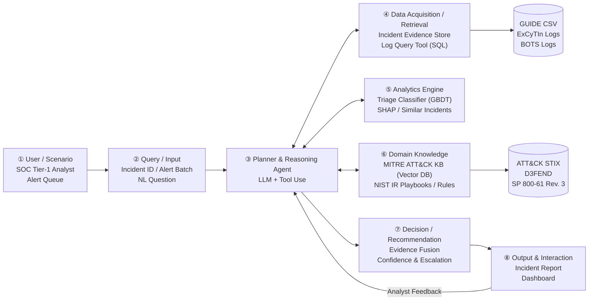
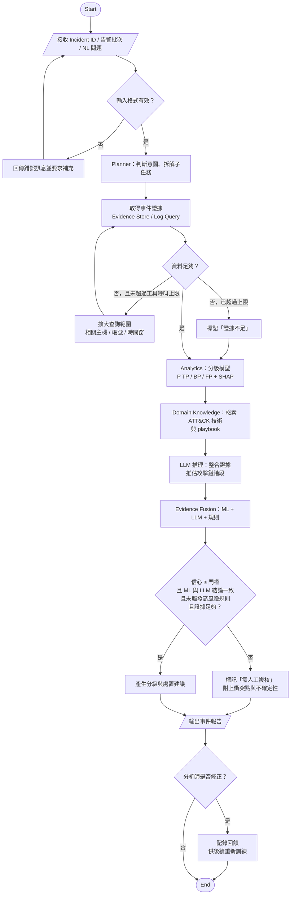

# Technical Design: AI SOC Analyst Agent

## Context

Enterprise Security Operations Centers (SOCs) are overwhelmed by alert fatigue caused by high false-positive and benign-positive rates [8][24]. While existing machine learning models (e.g., Microsoft CGR [1]) can classify alerts at scale, they lack attack-chain semantic context and explainability. Standalone tool-using LLM agents suffer from high false negative rates (>= 40.4%) [3] and fragile investigation benchmarks (reward 0.606 on ExCyTIn-Bench [4]), while fully autonomous systems induce human automation complacency [12]. 

This design specifies a hybrid, domain-informed architecture that bridges statistical ML triage, MITRE ATT&CK knowledge graphs, TreeSHAP feature explanations, and LLM-driven planning with an explicit human-in-the-loop escalation guardrail.

## Goals / Non-Goals

**Goals:**
- Provide calibrated, evidence-grounded incident triage across True Positive (TP), Benign Positive (BP), and False Positive (FP) classes.
- Construct verifiable evidence chains linking alerts to MITRE ATT&CK techniques, NIST SP 800-61 Rev. 3 incident playbooks, and raw log queries.
- Implement an automated escalation policy that hands unresolvable, low-confidence, or high-risk incidents over to human analysts.
- Support reproducible evaluation across Microsoft GUIDE and ExCyTIn-Bench benchmarks without data snooping.

**Non-Goals:**
- Replacing Tier-2/Tier-3 human incident responders or automating destructive containment actions without human approval.
- Training proprietary foundational Large Language Models from scratch.
- Full production deployment or SaaS multi-tenant cloud orchestration during this proposal refactor phase.

---

## Architecture & Components

The system decomposes into eight cooperative functional modules:



### Module Descriptions
- **① User / Scenario**: Tier-1 and Tier-2 SOC analysts managing queue backlogs and reviewing escalations.
- **② Query / Input**: Validates incoming incident IDs, alert batches, or natural language investigation questions against schemas.
- **③ Planner & Reasoning Agent**: ReAct-style LLM orchestrator responsible for tool selection, subtask decomposition, and loop control under budget $B$.
- **④ Data Acquisition / Retrieval**: High-throughput evidence extraction from GUIDE DuckDB tables and read-only SQL log queries in ExCyTIn.
- **⑤ Analytics Engine**: GBDT classifier (LightGBM/XGBoost) outputting $(p_{TP}, p_{BP}, p_{FP})$, TreeSHAP local attribution, and k-NN similar incident lookups.
- **⑥ Domain Knowledge Integration**: Vectorized ATT&CK STIX 2.1 knowledge base (Chroma DB), NIST SP 800-61 Rev. 3 playbooks, and Kill Chain risk rules (R1–R5).
- **⑦ Decision / Recommendation**: Synthesizes multi-modal evidence, computes confidence against threshold $\tau$, detects conflicts, and issues escalation directives.
- **⑧ Output & Interaction**: Generates dual-format reports (JSON/Markdown), interactive Streamlit visualization, and persists analyst feedback.

---

## Data Flow & Processing Pipeline

1. **Ingestion & Aggregation**: Alerts and evidence rows are ingested and aggregated into an Incident entity: `Evidence -> Alert -> Incident`.
2. **Planning & Multi-Hop Querying**: The Planner inspects available fields. If critical context (user, host, process) is absent, it executes targeted queries until sufficiency criterion `IsSufficient(E)` is satisfied or budget $B$ is reached.
3. **Parallel Analysis**:
   - Analytics Engine extracts tabular features, computes ML probabilities $p$, and derives TreeSHAP values $\phi$.
   - Knowledge Engine retrieves candidate ATT&CK techniques $T$ and playbook actions $K$.
4. **LLM Synthesis**: The Reasoner evaluates evidence $E$, prior probabilities $p$, and domain context $K$, outputting a qualitative label and confidence.
5. **Fusion & Escalation Check**: The fusion algorithm calculates combined score $s$, checks conflict flags and high-risk rules $Rules(T)$, and determines final verdict and status (`AUTO_TRIAGED` vs. `NEEDS_HUMAN_REVIEW`).
6. **Reporting & Feedback**: Detailed audit reports are generated and presented. Analyst overrides are captured in the feedback repository.

---

## Flowchart



---

## Algorithms & Pseudocode

### Algorithm 1: SOC Triage Agent

```text
Algorithm 1: SOC Triage Agent
Input : Incident request Q (incident ID, alert batch, or NL question)
        Triage model M, ATT&CK knowledge base KB, playbook set PB
        Confidence threshold τ, tool-call budget B
Output: Triage report R

01: req ← ValidateAndParse(Q)
02: if req is invalid then return ErrorReport("missing or malformed input")
03: plan ← Planner.Decompose(req)                 ▷ subtasks: gather, classify, map, recommend
04: E ← ∅ ; calls ← 0
05: repeat                                         ▷ evidence gathering loop
06:     tool ← Planner.SelectTool(plan, E)
07:     E ← E ∪ tool.Execute(req, E)               ▷ every item carries its source reference
08:     calls ← calls + 1
09: until Planner.IsSufficient(E) or calls ≥ B
10: x ← ExtractFeatures(E)
11: p ← M.PredictProba(x)                          ▷ p = (p_TP, p_BP, p_FP)
12: φ ← SHAP(M, x)                                 ▷ top contributing features
13: S ← RetrieveSimilarIncidents(x, k)
14: T ← MapToATTACK(E, KB)                         ▷ techniques, tactics, kill-chain stage
15: K ← KB.Retrieve(T) ∪ PB.Retrieve(T)            ▷ RAG context
16: llm ← LLM.Reason(E, p, φ, S, T, K)             ▷ returns label, rationale, confidence
17: (label, conf, flags) ← FuseEvidence(p, llm, Rules(T))      ▷ Algorithm 2
18: if conf < τ or "conflict" ∈ flags or "high_risk" ∈ flags or not Planner.IsSufficient(E) then
19:     R.status ← "NEEDS_HUMAN_REVIEW"
20: else
21:     R.status ← "AUTO_TRIAGED"
22: R.actions ← PB.Recommend(label, T)
23: R ← R ∪ {label, conf, evidence: E, shap: φ, similar: S, attack: T, rationale: llm.rationale, flags}
24: return R
```

### Algorithm 2: FuseEvidence

```text
Algorithm 2: FuseEvidence
Input : ML probabilities p, LLM output llm, rule results U
        Weights w_ml, w_llm (w_ml + w_llm = 1)
Output: label, confidence conf, flag set flags

01: flags ← ∅
02: q ← OneHotWithConfidence(llm.label, llm.confidence)
03: s ← w_ml · p + w_llm · q                      ▷ weighted class scores
04: label ← argmax(s) ; conf ← max(s)
05: if argmax(p) ≠ llm.label then flags ← flags ∪ {"conflict"}
06: if U contains a high-risk pattern then        ▷ e.g. late kill-chain stage
07:     flags ← flags ∪ {"high_risk"}
08:     if label ≠ TP and p_TP ≥ τ_safety then label ← TP    ▷ NFR2: prefer escalation
09: return (label, conf, flags)
```

---

## Decisions

### Decision 1: GBDT Backbone for Primary Probability Prior over Pure LLM
- **Choice**: Employ GBDT (LightGBM/XGBoost) trained on GUIDE telemetry for baseline class probabilities.
- **Alternatives Considered**: Direct zero-shot / few-shot prompting of LLMs for classification.
- **Rationale**: GUIDE contains ~13M evidence rows where titles and entity attributes are hashed IDs. GBDT processes incidents in milliseconds with zero inference cost, provides calibrated output probabilities, and integrates directly with TreeSHAP. Conversely, LLMs cannot infer semantic meaning from hashed IDs, cost ~$0.109 per alert [3], and miss over 40% of attacks when unassisted.

### Decision 2: Rule-Based Evidence Sufficiency (`IsSufficient(E)`)
- **Choice**: Enforce deterministic, rule-based criteria for stopping log investigations: (1) all alerts have associated evidence, (2) main account and host context is resolved, and (3) empty queries are corroborated against source logging continuity.
- **Alternatives Considered**: Allowing the LLM planner to autonomously declare when it has seen enough.
- **Rationale**: Tsegai et al. [3] proved that autonomous LLM agents terminate prematurely upon encountering the first empty query result. Hard rules prevent silent false-negative escapes.

### Decision 3: Safety-Biased Multi-Modal Fusion Engine
- **Choice**: Synthesize statistical ML outputs with symbolic Kill Chain rules ($Rules(T)$) and LLM qualitative reasoning, biasing toward TP whenever high-risk tactics (Exfiltration/Impact) or credential theft with lateral movement appear.
- **Alternatives Considered**: Majority voting or unweighted score averaging.
- **Rationale**: Under Asymmetric Error Cost (M3), missing a True Positive is catastrophic. Hardcoded rules enforce domain safety boundaries regardless of statistical noise.

---

## Risks / Trade-offs

- **[Risk: Anonymized GUIDE Telemetry]** GUIDE entity fields are numeric hashes, limiting LLM semantic reasoning.  
  $\rightarrow$ *Mitigation*: GBDT handles tabular hash features; LLM operates on readable fields (`Category`, `MitreTechniques`, `EntityType`) and is tested on un-anonymized ExCyTIn-Bench.
- **[Risk: Data Leakage across Incidents]** Random train/test split creates artificial data snooping [16].  
  $\rightarrow$ *Mitigation*: Strict `GroupKFold` split on `OrgId` + `IncidentId` and temporal evaluation across timeline windows.
- **[Risk: LLM API Cost Inflation]** Multi-hop queries across 1,000 test cases could become costly.  
  $\rightarrow$ *Mitigation*: Hard budget limit $B$ on tool calls per incident; stratified sampling of 200 incidents for rapid development.
- **[Risk: Analyst Automation Complacency]** Analysts blindly approve agent suggestions [12].  
  $\rightarrow$ *Mitigation*: Enforce mandatory TreeSHAP attribution displays and explicit conflict warnings requiring active analyst confirmation.

